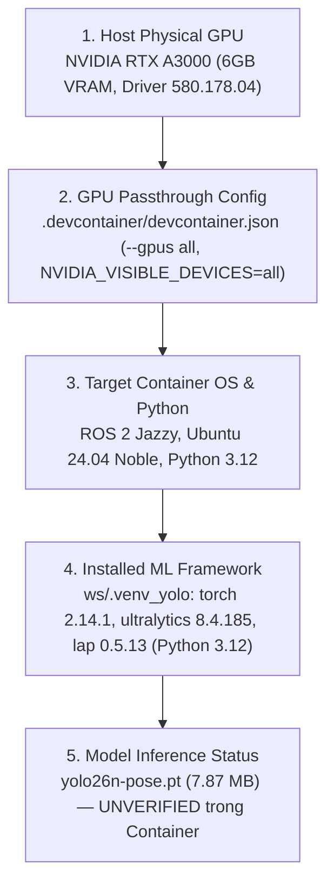
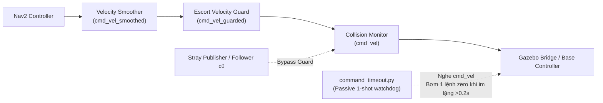

# PERSON TRACKING — PHỤ LỤC KHẢO SÁT KỸ THUẬT VÀ ĐÍNH CHÍNH (AUDIT ADDENDUM)

**Dự án:** Robot dẫn đường hành khách sân bay (ROS 2 Jazzy, Mecanum, Camera Astra sau)  
**Phân hệ:** `person_tracking`  
**Thời điểm lập:** 23/11/2026 — Phase 1  
**Baseline Git Commit:** `78ae0e51bdcbe4db4d536e96fa17a2d7ae8f9794`  
**Current HEAD:** `78ae0e51bdcbe4db4d536e96fa17a2d7ae8f9794` (trạng thái working tree sạch, bảo toàn toàn bộ thay đổi)  
**Evidence Log:** [.agent/person_tracking/evidence/phase_1/audit_addendum_commands.log](file:///home/thuytran/ws/src/.agent/person_tracking/evidence/phase_1/audit_addendum_commands.log)

---

## 1. Phân loại và Làm rõ Môi trường GPU / Runtime

Trong báo cáo Phase 0, kết luận về Python/PyTorch chưa phân tách rành mạch giữa môi trường Host và môi trường Container đích. Phụ lục này phân loại độc lập 5 tầng:



### 1.1. Host Physical GPU (Đã xác minh qua `nvidia-smi`)
- Card đồ họa: **NVIDIA RTX A3000 Laptop GPU** (VRAM: 6144 MiB).
- Driver version: `580.178.04`.
- CUDA capability tối đa của driver: `13.0`.
- **Lưu ý kỹ thuật:** Giá trị `CUDA Version: 13.0` trên `nvidia-smi` chỉ là phiên bản CUDA tối đa mà driver của host hỗ trợ, **không đồng nghĩa** với việc CUDA Toolkit hay PyTorch CUDA đã được cài đặt sẵn trên hệ điều hành host.

### 1.2. Cấu hình GPU Passthrough (Đã xác minh qua `.devcontainer/devcontainer.json`)
- File cấu hình Dev Container khai báo:
  - `runArgs: ["--gpus", "all", "--net=host", "--pid=host", "--ipc=host", "--privileged"]`.
  - `containerEnv: {"NVIDIA_VISIBLE_DEVICES": "all", "NVIDIA_DRIVER_CAPABILITIES": "all"}`.
- Cơ chế bind-mount đảm bảo container `ros:jazzy` có toàn quyền truy cập phần cứng GPU khi chạy trong VS Code Dev Container.

### 1.3. Runtime Container vs Runtime Host (Nguyên nhân chênh lệch trong Phase 0)
- **Host sandbox hiện tại:** Ubuntu 22.04 LTS (Jammy), Python 3.10.12 (`/usr/bin/python3`).
- **Dev Container đích:** Ubuntu 24.04 Noble, ROS 2 Jazzy, Python 3.12.
- **Khảo sát cấu trúc `.venv_yolo` tại `/home/thuytran/ws/.venv_yolo`:**
  - Thư mục thư viện thực tế: `/home/thuytran/ws/.venv_yolo/lib/python3.12/site-packages/`.
  - Bên trong chứa đầy đủ các gói:
    - `torch-2.14.1` (kèm các bản dựng runtime `nvidia_cuda_runtime-13.0.96`, `nvidia_cudnn_cu13-9.24.0.43`, `cuda_toolkit-13.0.3.0`).
    - `torchvision-0.29.1`.
    - `ultralytics-8.4.185`.
    - `opencv_python-4.11.0.86`.
    - `lap-0.5.13` (module Linear Assignment Problem bắt buộc cho ByteTrack).
    - `triton-3.8.0`.
- **Đính chính kỹ thuật:**
  - Trong Phase 0, khi chạy lệnh `/home/thuytran/ws/.venv_yolo/bin/python3`, symlink này trỏ tới `/usr/bin/python3` của **host** (Python 3.10). Python 3.10 không đọc thư mục `lib/python3.12/site-packages/` nên báo `ModuleNotFoundError: No module named 'torch'`.
  - Trên thực tế, `.venv_yolo` đã được cài đặt chuẩn bên trong Dev Container cho **Python 3.12**.
  - Tuy nhiên, do agent đang thực thi trong sandbox của host mà không thể chui vào container terminal trực tiếp trong phiên này, **trạng thái suy luận thực tế (model inference) và FPS benchmark vẫn được đánh dấu là CHƯA XÁC MINH (UNVERIFIED)**. Tuyệt đối không coi sự tồn tại của file checkpoint hay thư viện đã cài là bằng chứng inference thành công.

---

## 2. Đính chính Kỹ thuật về Tracker (`person_tracker.py`)

### 2.1. Đính chính về Kiểm tra Frame ID trong `on_images`
- **Nội dung đính chính:** Báo cáo Phase 0 nêu rằng `person_tracker.py` "hard-code kiểm tra `rgb_msg.frame_id == depth_msg.frame_id == camera_color_optical_frame`".
- **Sự thật trong mã nguồn ([person_tracker.py:145-148](file:///home/thuytran/ws/src/person_tracking/person_tracking/person_tracker.py#L145-L148)):**
  ```python
  if (rgb_msg.width, rgb_msg.height) != (depth_msg.width, depth_msg.height) or (
      info.width, info.height) != (rgb_msg.width, rgb_msg.height) or not (
      rgb_msg.header.frame_id == depth_msg.header.frame_id == info.header.frame_id):
      raise ValueError('RGB/depth/CameraInfo dimensions or frames do not match')
  ```
  Nhánh `on_images` **chỉ kiểm tra tính đồng nhất (equality) giữa ba header** (`rgb_msg`, `depth_msg`, `info`), chứ **không hard-code** tên chuỗi `'camera_color_optical_frame'` tại đây. Chuỗi `'camera_color_optical_frame'` chỉ xuất hiện làm giá trị fallback mặc định trong hàm `invalid()` ([dòng 75](file:///home/thuytran/ws/src/person_tracking/person_tracking/person_tracker.py#L75)) khi không có header truyền vào.
- **Quy tắc thiết kế:** Không bao giờ đề xuất gỡ bỏ các câu lệnh kiểm tra kích thước và frame ID này chỉ để làm cho node "chạy được". Nếu kích thước hoặc frame ID không khớp, đó là dấu hiệu dữ liệu không tương thích hình học; hệ thống phải xử lý an toàn thay vì bỏ qua kiểm tra.

### 2.2. Đính chính về Bộ lọc Độ phân tán Depth
- **Nội dung đính chính:** Báo cáo Phase 0 ghi nhầm bộ lọc phân tán là "IQR (Interquartile Range)".
- **Sự thật trong mã nguồn ([person_tracker.py:133-135](file:///home/thuytran/ws/src/person_tracking/person_tracking/person_tracker.py#L133-L135)):**
  ```python
  z = float(np.median(valid))
  if float(np.median(np.abs(valid - z))) > max(0.10, z * 0.08):
      return None, (a, c, b, d)
  ```
  Công thức `np.median(np.abs(valid - z))` là **Median Absolute Deviation (MAD)** (độ lệch tuyệt đối trung vị), một ước lượng độ phân tán vững (robust statistic) chống nhiễu ngoại lai. Thuật toán loại bỏ patch nếu MAD lớn hơn giá trị lớn nhất giữa `0.10m` và `8% cự ly z`. Đây là kỹ thuật xử lý ảnh hợp lý và sẽ được bảo lưu trong thiết kế Phase 1.

---

## 3. Khảo sát Chuyên sâu về Cơ chế Đăng ký Depth của Astra Driver

Mã nguồn tại [ros2_astra_camera/astra_camera/src/ob_camera_node.cpp:491-503](file:///home/thuytran/ws/src/ros2_astra_camera/astra_camera/src/ob_camera_node.cpp#L491-L503):

```cpp
void OBCameraNode::setImageRegistrationMode(bool enable) {
  if (!device_->isImageRegistrationModeSupported(openni::IMAGE_REGISTRATION_DEPTH_TO_COLOR)) {
    RCLCPP_WARN_STREAM(logger_, "Current do not support " << magic_enum::enum_name(
                                    openni::IMAGE_REGISTRATION_DEPTH_TO_COLOR));
    return;
  }
  auto mode = enable ? openni::IMAGE_REGISTRATION_DEPTH_TO_COLOR : openni::IMAGE_REGISTRATION_OFF;
  auto rc = device_->setImageRegistrationMode(mode);
  if (rc != openni::STATUS_OK) {
    RCLCPP_ERROR(logger_, "Enabling image registration mode failed: \n%s\n",
                 openni::OpenNI::getExtendedError());
  }
}
```

### 3.1. Các tình huống Thất bại và Nguy cơ Frame ID Giả mạo
1. **Thiết bị không hỗ trợ:** Nếu camera Astra cụ thể (hoặc firmware) không hỗ trợ `IMAGE_REGISTRATION_DEPTH_TO_COLOR`, hàm in cảnh báo và `return` ngay mà không kích hoạt đăng ký phần cứng.
2. **Kích hoạt thất bại:** Nếu thiết bị trả về mã lỗi (`rc != openni::STATUS_OK`), hàm ghi log lỗi nhưng node **tiếp tục chạy**.
3. **Nguy cơ frame_id giả mạo ([ob_camera_node.cpp:528-529, 550-551](file:///home/thuytran/ws/src/ros2_astra_camera/astra_camera/src/ob_camera_node.cpp#L528-L551)):**
   ```cpp
   image_msg->header.frame_id =
       depth_registration_ ? depth_aligned_frame_id_[stream_index] : optical_frame_id_[stream_index];
   ```
   Biến `depth_registration_` là giá trị tham số cấu hình ROS (`true/false`). Driver **không hạ cờ `depth_registration_` về `false`** khi `setImageRegistrationMode` thất bại! Do đó, driver vẫn phát hành ảnh depth với `frame_id = depth_aligned_frame_id_` (tức `camera_color_optical_frame`), ngay cả khi việc căn chỉnh phần cứng đã thất bại hoàn toàn!

### 3.2. Yêu cầu Thiết kế cho Phân hệ Tracking
- **Không suy diễn alignment từ frame ID:** Việc `depth_msg.header.frame_id == camera_color_optical_frame` không đủ để khẳng định các pixel depth đã được căn chỉnh hoàn hảo với pixel RGB.
- **Chế độ kiểm chứng hình học:** Phân hệ tracking phải thiết kế rõ hai trạng thái:
  - `DEPTH_PROVEN_ALIGNED`: Đã qua kiểm thử hiệu chuẩn thực tế với mốc vật lý hoặc calibration data.
  - `DEPTH_UNVERIFIED_ALIGNMENT`: Khi chưa có bằng chứng căn chỉnh thực địa, depth chỉ được dùng làm ước lượng thô có gắn cờ cảnh báo, và không được dùng để đưa ra các quyết định điều khiển bám góc quay gắt.

---

## 4. Khảo sát Chuyên sâu về Chuỗi Vận tốc và Watchdog `command_timeout.py`

### 4.1. Bản chất Node `command_timeout` ([linorobot2_gazebo/command_timeout.py](file:///home/thuytran/ws/src/linorobot2/linorobot2_gazebo/linorobot2_gazebo/command_timeout.py#L21-L56))
- Khởi chạy trong file [linorobot2_gazebo/launch/gazebo.launch.py:161](file:///home/thuytran/ws/src/linorobot2/linorobot2_gazebo/launch/gazebo.launch.py#L161).
- **Hành vi hoạt động:**
  - Vừa subscribe `cmd_vel` ([dòng 30](file:///home/thuytran/ws/src/linorobot2/linorobot2_gazebo/linorobot2_gazebo/command_timeout.py#L30)), vừa publish `cmd_vel` ([dòng 26](file:///home/thuytran/ws/src/linorobot2/linorobot2_gazebo/linorobot2_gazebo/command_timeout.py#L26)).
  - Trong `twist_callback`: Nếu nhận được lệnh có bất kỳ thành phần nào khác 0, ghi nhận `self.prev_cmd_time_ = now` và `self.zero_cmd_sent_ = False`. Bỏ qua lệnh 0 ([dòng 51](file:///home/thuytran/ws/src/linorobot2/linorobot2_gazebo/linorobot2_gazebo/command_timeout.py#L51)).
  - Trong `brake_timer_callback` (tần số 5 Hz / 0.2s): Nếu `dt >= 200 ms` và chưa gửi lệnh 0 (`not self.zero_cmd_sent_`), node sẽ phát **duy nhất 1 lần** một bản tin `Twist` có toàn bộ vận tốc bằng 0, rồi đặt `self.zero_cmd_sent_ = True`.

### 4.2. Phân tích Tương tác An toàn và Lỗ hổng Tiềm ẩn



1. **Watchdog thụ động (Passive Watchdog):** `command_timeout` chỉ can thiệp khi trên topic `cmd_vel` **hoàn toàn im lặng** trong hơn 200 ms.
2. **Kịch bản Guard bị sập (Guard Crash):**
   - Nếu `escort_velocity_guard` bị crash đột ngột khi đang cho phép robot chạy:
   - Topic `cmd_vel_guarded` bị ngắt nguồn phát.
   - `collision_monitor` có tham số `source_timeout: 1.0s` ([navigation.yaml:299](file:///home/thuytran/ws/src/linorobot2/linorobot2_navigation/config/navigation.yaml#L299)). Trong suốt 1.0 giây đó, Collision Monitor vẫn tiếp tục duy trì trạng thái trước đó hoặc chờ hết `stop_pub_timeout: 2.0s`.
   - `command_timeout` chỉ can thiệp nếu Collision Monitor dừng phát lệnh ra `cmd_vel`. Tổng thời gian trễ trước khi robot dừng hẳn có thể lên tới 1.2–2.0 giây!
3. **Kịch bản Nguồn phát Lạ Bỏ qua Guard (Publisher Bypass):**
   - Nếu có một node khác (như `teleop_twist_keyboard` hoặc `person_follower` cũ) tiếp tục phát lệnh trực tiếp vào `cmd_vel`:
   - `command_timeout` liên tục nhận được lệnh khác 0 và sẽ **liên tục reset bộ đếm thời gian**, hoàn toàn không bao giờ phát lệnh dừng!
   - `command_timeout` không có quyền chặn (block) các bản tin vận tốc trái phép.
4. **Kết luận thiết kế an toàn:**
   - Không được dựa dẫm vào `command_timeout.py` làm chốt an toàn duy nhất.
   - `escort_velocity_guard` bắt buộc phải thực hiện **cơ chế ép 0 chủ động (Active Continuous Zeroing)**: Khi ở trạng thái dừng, Guard liên tục phát bản tin vận tốc 0 ở tần số 20 Hz vào chuỗi điều khiển, ghi đè mọi dữ liệu sót, thay vì chỉ im lặng không gửi gì.

---

## 5. Danh mục Bằng chứng và Lệnh Thực thi Bổ sung

Các lệnh kiểm tra môi trường, framework PyTorch và source code đã được lưu trữ nguyên văn tại:
- Bằng chứng lệnh thô: [.agent/person_tracking/evidence/phase_1/audit_addendum_commands.log](file:///home/thuytran/ws/src/.agent/person_tracking/evidence/phase_1/audit_addendum_commands.log).
