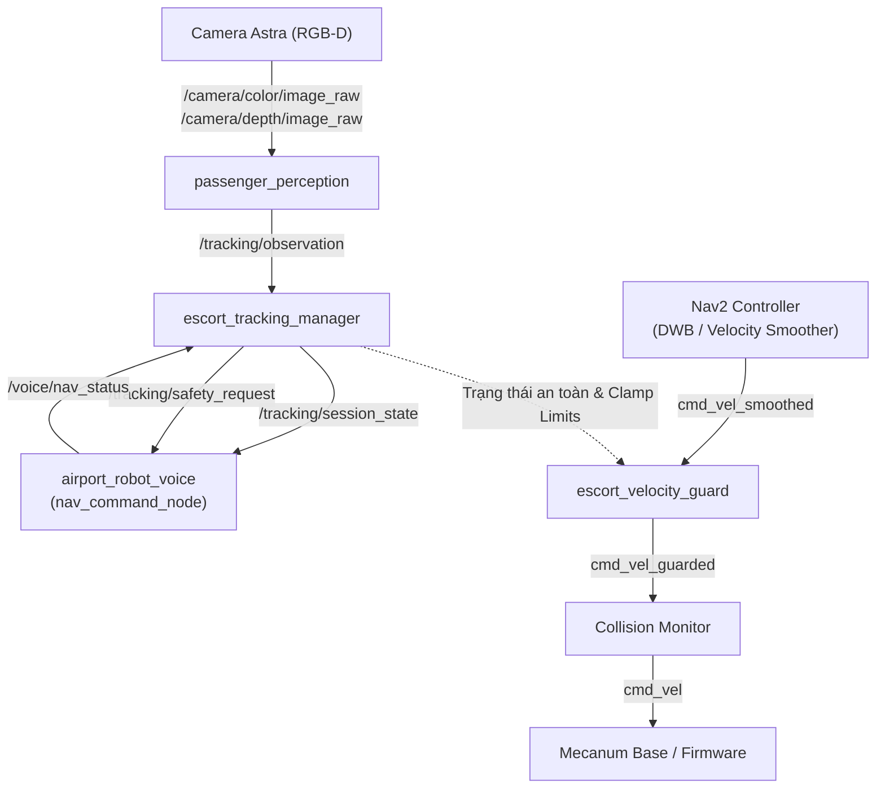
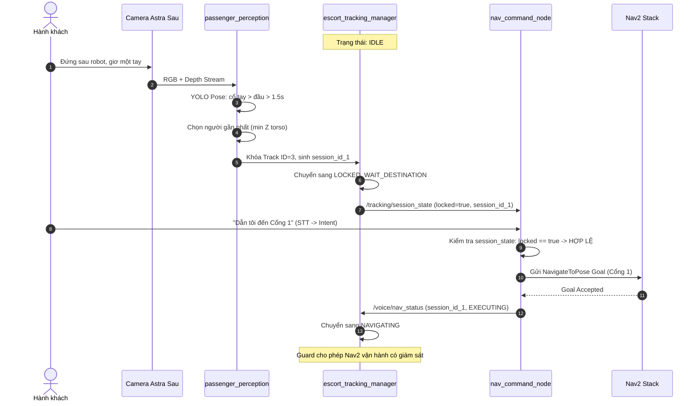
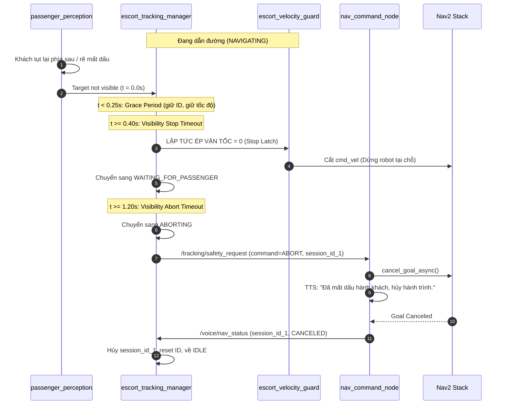

# PERSON TRACKING — DỰ THẢO HỢP ĐỒNG GIAO DIỆN (INTERFACES CONTRACT)

**Phân hệ:** `person_tracking`  
**Phiên bản dự thảo:** 0.1 — 20/11/2026 (Phase 0)  
**Trạng thái:** DỰ THẢO KỸ THUẬT (Proposal & Draft Contract)  
**Mục tiêu:** Định nghĩa hợp đồng giao tiếp độc lập giữa `person_tracking`, `airport_robot_voice`, và chuỗi điều khiển Nav2.

> [!IMPORTANT]
> Đây là bản hợp đồng ranh giới được đề xuất từ phía phân hệ Tracking dựa trên kết quả audit Phase 0. Phân hệ Tracking **tuyệt đối không can thiệp mã nguồn voice**. Các yêu cầu đối với voice sẽ được chuyển giao qua kênh giao tiếp giữa hai agent để chủ dự án xem xét và duyệt triển khai ở Phase 9.

---

## 1. Nguyên tắc cốt lõi về phân quyền (Ownership Principles)

1. **Voice sở hữu duy nhất `NavigateToPose`:**
   - Chỉ có `airport_robot_voice` (cụ thể là `nav_command_node.py`) được phép khởi tạo `ActionClient<NavigateToPose>`, gửi Goal, gọi Cancel Goal, và nhận Result/Feedback từ Nav2.
   - `person_tracking` **không bao giờ** trực tiếp gọi `NavigateToPose`.
2. **Tracking sở hữu trạng thái Khách hàng & Cổng An toàn Vận tốc:**
   - Tracking quản lý vòng đời nhận diện: từ lúc robot đứng yên quét cử chỉ, khóa khách hàng (`LOCKED`), cấp `session_id`, theo dõi cự ly/vị trí, đến khi phát hiện mất khách hoặc chuyến đi kết thúc.
   - Tracking sở hữu `escort_velocity_guard`: cơ chế cổng an toàn có khả năng cưỡng bức vận tốc về 0 ngay lập tức khi phát hiện tình huống nguy hiểm, không phụ thuộc vào việc voice đã hủy goal xong hay chưa.
3. **Chống lệnh cũ và trạng thái lạc hậu (Session & Correlation ID):**
   - Mọi bản tin trao đổi giữa Voice và Tracking bắt buộc phải có `session_id` (UUID phiên) và `goal_attempt_id` (UUID lệnh điều hướng).
   - Tuyệt đối không chấp nhận thông báo thành công (`SUCCEEDED`) hoặc ACK của phiên trước áp dụng cho phiên hiện tại.

---

## 2. Danh mục Giao diện Hệ thống (System Topics & Services)



---

## 3. Chi tiết Đặc tả Giao diện đề xuất

### 3.1. Tracking -> Voice: `/tracking/session_state`
- **Mục đích:** Thông báo trạng thái khóa của hành khách để Voice kiểm tra điều kiện tiên quyết trước khi nhận điểm đến.
- **Publisher:** `escort_tracking_manager`
- **Subscriber:** `airport_robot_voice/nav_command_node`
- **QoS:** Depth=1, Durability=TRANSIENT_LOCAL, Reliability=RELIABLE.
- **Chu kỳ:** Phát ngay khi có chuyển trạng thái (Event-driven) và phát định kỳ nhịp tim 5 Hz.
- **Cấu trúc dữ liệu đề xuất (JSON Payload qua `std_msgs/msg/String` hoặc Custom Msg):**
  ```json
  {
    "schema_version": "1.0",
    "timestamp": 1732100000.123,
    "session_id": "urn:uuid:f47ac10b-58cc-4372-a567-0e02b2c3d479",
    "state": "LOCKED_WAIT_DESTINATION",
    "locked": true,
    "target_id": 3,
    "target_distance_m": 1.48,
    "confidence": 0.92,
    "reason": "VALID_HAND_RAISE_HELD_NEAREST"
  }
  ```
- **Quy tắc nghiệm thu tại Voice:**
  - Nếu `locked == false` hoặc `state == "IDLE"`: Voice từ chối mọi yêu cầu đi tới điểm đến (Ví dụ: thông báo "Xin vui lòng giơ tay để tôi nhận diện bạn trước").
  - Khi `locked == true` và `state == "LOCKED_WAIT_DESTINATION"`: Voice cho phép nhận lệnh đích và bắt đầu gửi goal sang Nav2.

---

### 3.2. Tracking -> Voice: `/tracking/safety_request`
- **Mục đích:** Tracking yêu cầu Voice thực hiện thao tác trên vòng đời điều hướng (dừng tạm thời hoặc hủy hẳn chuyến đi) khi phát hiện mất dấu khách hoặc bất thường an toàn.
- **Publisher:** `escort_tracking_manager`
- **Subscriber:** `airport_robot_voice/nav_command_node`
- **QoS:** Depth=10, Reliability=RELIABLE.
- **Cấu trúc dữ liệu đề xuất:**
  ```json
  {
    "schema_version": "1.0",
    "timestamp": 1732100005.456,
    "session_id": "urn:uuid:f47ac10b-58cc-4372-a567-0e02b2c3d479",
    "request_id": "urn:uuid:8b0a1d63-3b1a-4f5e-9e7f-6d2c1e8a9b0c",
    "command": "ABORT",
    "reason_code": "PROLONGED_TARGET_LOSS",
    "message": "Không quan sát thấy hành khách trong hơn 1.2 giây"
  }
  ```
- **Các giá trị `command`:**
  - `WAIT`: Khách tụt lại xa nhưng vẫn trong tầm mắt; yêu cầu Nav2 tạm dừng chờ khách bắt kịp.
  - `ABORT`: Mất khách kéo dài hoặc xác nhận khách rời khỏi khung hình; yêu cầu Voice hủy Goal hiện tại và thông báo hành khách.
  - `RESUME`: Khách đã tiến lại gần vùng an toàn; cho phép tiếp tục hành trình.
- **Ràng buộc an toàn:** Cùng thời điểm phát bản tin này, `escort_velocity_guard` đã **ngay lập tức ép vận tốc về 0**. Việc gửi bản tin này chỉ để Voice dọn dẹp Goal trên Nav2 và tương tác âm thanh, không phải chờ Voice hủy xong mới dừng xe.

---

### 3.3. Voice -> Tracking: `/voice/nav_status`
- **Mục đích:** Voice báo cáo tiến độ và kết quả điều hướng của Nav2 cho Tracking để đồng bộ FSM (đặc biệt khi tới đích thành công để xóa khóa khách).
- **Publisher:** `airport_robot_voice/nav_command_node`
- **Subscriber:** `escort_tracking_manager`
- **QoS:** Depth=1, Durability=TRANSIENT_LOCAL, Reliability=RELIABLE.
- **Cấu trúc dữ liệu đề xuất (hoặc tái sử dụng trường từ `/voice/nav_state` hiện có):**
  ```json
  {
    "schema_version": "1.0",
    "timestamp": 1732100060.789,
    "session_id": "urn:uuid:f47ac10b-58cc-4372-a567-0e02b2c3d479",
    "goal_attempt_id": "urn:uuid:2a3b4c5d-6e7f-8a9b-0c1d-2e3f4a5b6c7d",
    "nav_event": "GOAL_SUCCEEDED",
    "mission_state": "ARRIVED",
    "target_id": "gate_1"
  }
  ```
- **Hành vi khi nhận:**
  - Nếu `session_id` khớp phiên hiện tại và `nav_event == "GOAL_SUCCEEDED"`: Tracking chuyển FSM sang `ARRIVED`, xóa khóa `selected_id`, xóa phiên, đưa Guard về 0, và trở về `IDLE` (tuân thủ Quyết định D06).
  - Nếu `session_id` không khớp (kết quả trễ của phiên cũ): Bỏ qua, không thay đổi trạng thái.

---

### 3.4. Perception -> Manager: `/tracking/observation` (Nội bộ Tracking)
- **Mục đích:** Cung cấp thông tin đo đạc thô có lọc nhiễu từ camera sau cho bộ điều phối FSM.
- **Topic:** `/tracking/observation`
- **QoS:** Sensor Data (Best Effort, depth=1) hoặc Reliable depth=1.
- **Các trường dữ liệu:**
  - `header`: timestamp và frame_id quang học (`camera_color_optical_frame`).
  - `tracks_count`: số lượng người phát hiện trong khung hình.
  - `hand_raise_candidates`: danh sách các ID đang giơ tay kèm thời gian đã giữ liên tục.
  - `locked_track_id`: ID hành khách được theo dõi (nếu có).
  - `locked_track_depth`: Khoảng cách mét tính từ cụm depth torso.
  - `depth_valid`: boolean báo depth đo được có tin cậy hay không (không dùng giá trị 0 hoặc NaN).
  - `u_norm`, `v_norm`: Tọa độ tâm người chuẩn hóa từ [-1.0, 1.0].
  - `near_edge_warning`: Cờ cảnh báo khách chuẩn bị lọt khỏi mép FOV.
  - `confidence`: Chỉ số tin cậy tổng hợp (0.0 đến 1.0).

---

### 3.5. Nav2 Smoother -> Guard -> Collision Monitor: Chuỗi Vận tốc
- **Kiểu bản tin:** `geometry_msgs/msg/Twist` (khớp toàn bộ stack hiện có của Linorobot2).
- **Luồng dữ liệu:**
  1. `cmd_vel_smoothed` (xuất từ `velocity_smoother` của Nav2, tần số 20 Hz).
  2. `escort_velocity_guard` lắng nghe `cmd_vel_smoothed`.
  3. `escort_velocity_guard` xuất ra `cmd_vel_guarded` (hoặc remap thích hợp).
  4. `collision_monitor` lắng nghe `cmd_vel_guarded`, kiểm tra quét laser vật cản xung quanh thân xe mecanum, và xuất lệnh cuối cùng ra `/cmd_vel` cho motor driver / micro-ROS base.

---

## 4. Sơ đồ Tuần tự Hoạt động (Sequence Diagrams)

### 4.1. Kịch bản Khóa khách và Khởi hành dẫn đường (Happy Path)



---

### 4.2. Kịch bản Mất khách kéo dài và Hủy phiên an toàn (Prolonged Loss & Fail-safe)



---

## 5. Chiến lược Kiểm thử Độc lập bằng Mock Node (Phase 2–8)

Vì `airport_robot_voice` phát triển song song trong cuộc hội thoại khác, phân hệ Tracking sẽ xây dựng một node giả lập:
- Tên: `mock_voice_owner.py` (nằm hoàn toàn trong `person_tracking/test/` hoặc nội bộ tracking).
- Chức năng: Giả lập việc nhận `/tracking/session_state`, kiểm tra cờ `locked`, giả lập việc phát `/voice/nav_status` và phản hồi yêu cầu `/tracking/safety_request`.
- Đảm bảo toàn bộ Phase 2 đến Phase 8 được tự động hóa kiểm thử 100% trong package `person_tracking` mà không phụ thuộc vào tiến độ của agent voice.
