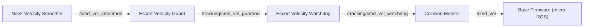
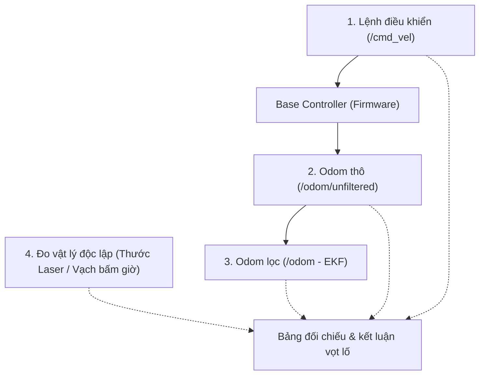

# PERSON TRACKING — CẨM NANG CHUẨN BỊ VÀ NGHIỆM THU PHASE 11
## Hướng Dẫn Vận Hành Phần Cứng Thực Tế: Camera Orbbec Astra & Robot Mecanum

- **Phân hệ:** `person_tracking`
- **Phiên bản:** 1.2 — 24/11/2026 (Audit & Overlay Update)
- **Trạng thái phân hệ:** **SOFTWARE_READY / HARDWARE_PENDING** (Ca T06: **PARTIAL / CODE_READY**)
- **Mục tiêu:** Cung cấp quy trình kiểm tra từng bước, bộ lệnh tái hiện, bảng tiêu chí Pass/Fail, công cụ chẩn đoán chuyên dụng và phương án đấu nối overlay sẵn sàng khi kết nối phần cứng thực tế (Camera Orbbec Astra Pro và khung gầm Robot Mecanum Linorobot2).
- **Quy tắc An toàn Cốt lõi (Safety Mandate):**
  > [!IMPORTANT]
  > **TÁCH BIỆT HOÀN TOÀN GIỮA KIỂM TRA TẠI CHỖ VÀ THỬ CHUYỂN ĐỘNG:**
  > 1. Toàn bộ các bước kiểm tra camera Astra, topic ROS, TF, depth registration, thuật toán nhận diện và watchdog phải được thực hiện khi **xe đứng yên hoặc kê 4 bánh xe hổng khỏi sàn (Stationary Bench Testing)**.
  > 2. Thử nghiệm chuyển động chỉ được tiến hành sau khi hoàn thành toàn bộ kiểm tra tĩnh, **ở tốc độ thấp ($v_{x,\max} \le 0.30\text{ m/s}$)**, trong khu vực có kiểm soát, có người giám sát đi kèm và **công tắc E-stop vật lý đã được xác nhận hoạt động**.
  > 3. Tuyệt đối **không tự ý kích hoạt chuyển động** trong lượt chuẩn bị này.

---

## 1. QUY ƯỚC MÔI TRƯỜNG, ROS DOMAIN VÀ PHÂN QUYỀN

### 1.1 Quy ước ROS_DOMAIN_ID
- **Ghép nối hệ thống chính (Main System Integration):** Bắt buộc sử dụng `ROS_DOMAIN_ID=0` (đồng bộ với Voice, Nav2 và Base Controller).
- **Kiểm thử cô lập hoặc chẩn đoán riêng (Isolated Diagnostic Tests):** Sử dụng `ROS_DOMAIN_ID=43` (Perception/ROS runtime) hoặc `ROS_DOMAIN_ID=44` (Gazebo/Simulation baseline).

### 1.2 Phân lập Build Workspace
Luôn build và nạp môi trường phân hệ `person_tracking` cách ly:
```bash
cd /home/ws
source /opt/ros/jazzy/setup.bash
colcon build \
  --packages-select person_tracking \
  --build-base build_tracking \
  --install-base install_tracking \
  --symlink-install
source /home/ws/install_tracking/setup.bash
```

### 1.3 Nguyên tắc Phân quyền Điều khiển & Chuỗi Escort Hoàn chỉnh



- **Voice Agent:** Chủ sở hữu **duy nhất** của Action Client `NavigateToPose`. Phân hệ Tracking tuyệt đối không tạo action client hay phát goal trực tiếp tới Nav2.
- **Tracking Manager:** Bên **duy nhất** cấp `session_id`, xác thực cử chỉ khóa khách và gửi `safety_request` (ABORT/STOP).
- **Velocity Guard & Watchdog:** Cổng an toàn độc lập chốt chặn vận tốc, kẹp cứng $v_y = 0.0000\text{ m/s}$, dập zero ở 20 Hz độc lập khi mất quan sát hoặc mất lệnh.
- **Chuỗi Điều khiển Vận tốc Escort Hoàn chỉnh (Chained Escort Pipeline):**
  $$\text{Nav2 Smoother} \xrightarrow{\text{/cmd\_vel\_smoothed}} \text{Guard} \xrightarrow{\text{/tracking/cmd\_vel\_guarded}} \text{Watchdog} \xrightarrow{\text{/tracking/cmd\_vel\_watchdog}} \text{Collision Monitor} \xrightarrow{\text{/cmd\_vel}} \text{Base}$$
  * **Input của Guard:** Bắt buộc là `/cmd_vel_smoothed` (lệnh vận tốc đã làm mượt từ Nav2).
  * **Output của Guard:** `/tracking/cmd_vel_guarded`.
  * **Input của Watchdog:** `/tracking/cmd_vel_guarded`.
  * **Output của Watchdog:** `/tracking/cmd_vel_watchdog`.
  * **Input của Collision Monitor:** Bắt buộc là `/tracking/cmd_vel_watchdog`.
  * **Output của Collision Monitor:** Topic `/cmd_vel` duy nhất cấp lệnh tới vi điều khiển của khung gầm.

---

## 2. DANH SÁCH BƯỚC CẦN NGƯỜI DÙNG CÓ MẶT VÀ KẾT NỐI PHẦN CỨNG

Dưới đây là các thao tác vật lý bắt buộc cần sự có mặt của người vận hành:

| STT | Bước thao tác vật lý | Thiết bị liên quan | Mục đích & Lưu ý |
|---|---|---|---|
| **HW-01** | Cắm cáp USB Camera Astra | Orbbec Astra Pro / Máy tính robot | Cắm vào cổng USB 3.0 (màu xanh) để đảm bảo băng thông RGB-D 30 FPS. |
| **HW-02** | Cắm cáp USB Microcontroller | Microcontroller (micro-ROS) | Cắm vào cổng USB của máy tính robot (`/dev/ttyACM0` hoặc `/dev/ttyUSB0`). |
| **HW-03** | Kê kích 4 bánh xe hổng sàn | Khung gầm Mecanum | Kê 4 bánh xe không chạm sàn trong toàn bộ Giai đoạn 1 (Stationary Bench Test). |
| **HW-04** | Kiểm tra công tắc E-Stop vật lý | Nút dừng khẩn cấp vật lý | Nhấn thử E-stop để xác nhận mạch ngắt nguồn động cơ hoạt động ngay lập tức. |
| **HW-05** | Bố trí mốc khoảng cách dán sàn | Thước dây & băng dính sàn | Dán vạch mốc tại $0.5\text{ m}, 1.0\text{ m}, 1.5\text{ m}, 2.0\text{ m}, 2.5\text{ m}, 3.0\text{ m}$ phía sau robot. |
| **HW-06** | Đóng vai hành khách / cắt ngang | Người giám sát & cộng sự | Người A đứng khóa session; Người B đi cắt ngang để kiểm chứng ca T06. |

---

## 3. GIAI ĐOẠN 1: KIỂM TRA TẠI CHỖ KHÔNG CHẠY XE (STATIONARY BENCH TESTING)

### 3.1 Kiểm tra Phần cứng và Driver Camera Astra (3 Bước Độc lập)

Quy trình kiểm tra camera được tách bạch thành 3 bước độc lập rõ ràng:

#### Bước A: Kiểm tra Luồng Dữ liệu (Stream Check)
1. **Xác nhận kết nối thiết bị USB:**
   ```bash
   lsusb | grep -i -E "(orbbec|astra|2bc5)"
   ls -la /dev/video*
   ```
   *Yêu cầu:* Xuất hiện thiết bị UVC Color (`2bc5:0501`) và OpenNI Depth (`2bc5:0403`).
2. **Kiểm tra udev rules:**
   Đảm bảo file `/etc/udev/rules.d/56-orbbec-usb.rules` đã được nạp để cấp quyền truy cập thiết bị không cần root:
   ```bash
   sudo udevadm control --reload-rules && sudo udevadm trigger
   ```
3. **Khởi chạy Astra Camera Driver:**
   ```bash
   export ROS_DOMAIN_ID=0
   source /opt/ros/jazzy/setup.bash
   ros2 launch astra_camera astra_pro.launch.xml depth_registration:=true
   ```
4. **Kiểm tra topic và encoding:**
   - Topic Color: `/camera/color/image_raw` (encoding: `rgb8` hoặc `bgr8`, tần số 20–30 Hz).
   - Topic Depth: `/camera/depth/image_raw` (encoding: `16UC1` đơn vị mm, tần số 20–30 Hz).
   - Topic CameraInfo: `/camera/color/camera_info` (K ma trận hợp lệ, $f_x, f_y, c_x, c_y > 0$).

#### Bước B: Kiểm tra Ghép đôi Thời gian (Timestamp Pairing Check)
Chạy script chẩn đoán tự động:
```bash
python3 /home/ws/src/person_tracking/test/check_astra_hardware_topics.py
```
- **Chênh lệch timestamp:** Độ lệch thời gian giữa RGB và Depth bắt buộc đạt:
  $$\Delta t = |t_{\text{rgb}} - t_{\text{depth}}| \le 0.060\text{ s} \quad (60\text{ ms})$$
- **Độ tuổi frame (Frame Age):** Frame đến không bị trễ đọng buffer:
  $$t_{\text{now}} - t_{\text{stamp}} \le 0.400\text{ s}$$

#### Bước C: Chứng minh Căn chỉnh Phần cứng D2C (Hardware Depth Registration Proof)
- Xác nhận chế độ đăng ký phần cứng Depth-to-Color (D2C) đang hoạt động trong driver Astra (`depth_registration:=true`).
- Kiểm tra point cloud tại `/camera/depth_registered/points` hoặc lớp phủ RGB-D: biên dạng độ sâu phải trùng khớp hình dạng màu sắc của vật thể, không bị bóng mờ hay lệch pha.

---

### 3.2 Quy ước Hệ Tọa độ Quang học (ADR-10), TF Tree & Gating An toàn

#### 1. Hệ Tọa độ Quang học và Chiều Camera per ADR-10
Camera Orbbec Astra Pro được lắp ở đuôi xe hướng về phía sau ($x < 0$ so với tâm robot `base_link`, góc quay $yaw \approx 180^\circ$ hay $\pi\text{ rad}$).

> [!NOTE]
> **Quy ước Hệ Tọa độ Quang học Chuẩn (Optical Convention per ADR-10):**
> Tên frame quang học chuẩn: `camera_color_optical_frame` (khác với link vật lý `camera_link`).
> - **Trục $+Z_{\text{opt}}$:** Hướng dọc theo trục quang học thẳng ra ngoài ống kính. Vì camera quay ra sau xe, $+Z_{\text{opt}}$ hướng ngược chiều tiến của robot (tương ứng $-X_{\text{base}}$).
> - **Trục $+X_{\text{opt}}$:** Hướng sang bên phải của mặt phẳng ảnh (tương ứng $+Y_{\text{base}}$, tức hướng sang bên trái của robot khi nhìn xuôi).
> - **Trục $+Y_{\text{opt}}$:** Hướng chúi xuống dưới đáy của mặt phẳng ảnh (tương ứng $-Z_{\text{base}}$, tức hướng thẳng xuống mặt sàn).

#### 2. Kiểm tra TF Tree
Chạy lệnh kiểm tra tính liên tục và đúng đắn của TF tree:
```bash
ros2 run tf2_ros tf2_echo base_link camera_link
ros2 run tf2_ros tf2_echo camera_link camera_color_optical_frame
```
*Yêu cầu:* TF tree liên tục, không đứt đoạn, frame_id quang học đúng chuẩn `camera_color_optical_frame`.

#### 3. Cơ chế Khóa Cổng An toàn khi Chưa Chứng minh Căn chỉnh Depth (`UNVERIFIED_ALIGNMENT`)
Node `person_detector_node` mặc định cấu hình `require_hardware_alignment_proof = True`.
- Nếu chưa có bằng chứng căn chỉnh D2C từ phần cứng, node xuất bản tin `/tracking/observation` với telemetry chẩn đoán:
  * `data_quality: "UNVERIFIED_ALIGNMENT"`
  * `is_metric_valid: false`
  * `candidates[i]["depth_valid"]: false`
  * `depth_proven: false`
- **Phản ứng của Velocity Guard:** Guard lập tức nhận diện trạng thái này và đánh giá:
  $$(False, \text{"DEGRADED_UNVERIFIED_DEPTH"})$$
  khóa chặt cổng vận tốc, xuất liên tục lệnh dừng $0.0000\text{ m/s}$ ra `/tracking/cmd_vel_guarded`.
- **Ranh giới nghiệm thu:** Các bài đo sai số cự ly mốc thật ($0.5\text{ m} - 3.0\text{ m}$), profiling tải node thật và ca T06 người cắt ngang tiếp tục duy trì trạng thái **PENDING HARDWARE/VIDEO** cho đến khi kết nối camera thật và hoàn tất chứng minh căn chỉnh D2C.
- Chỉ sau khi người vận hành đã kiểm tra trực quan xác nhận ảnh RGB và Depth khớp nhau hoàn toàn trên camera thật, mới được phép chạy với cờ tham số:
  `ros2 launch person_tracking perception_pipeline.launch.py require_hardware_alignment_proof:=false`

---

### 3.3 Khởi chạy Perception Pipeline & Profiling Tải Node Thật theo PID
1. **Khởi chạy Pipeline:**
   ```bash
   ros2 launch person_tracking perception_pipeline.launch.py \
     source_mode:=live_astra \
     model_path:=/home/ws/yolo26n-pose.pt \
     device:=cuda:0
   ```
2. **Chạy script Profile PID trong cửa sổ 45s:**
   ```bash
   python3 /home/ws/src/person_tracking/test/profile_detector_pid.py --duration 45 --domain 0
   ```
   *Tiêu chí nghiệm thu:*
   - Đo đúng PID của tiến trình `PersonDetectorNode`.
   - CPU Usage: $\le 45\%$ trên 1 core CPU qua cửa sổ 45s.
   - RAM RSS: $\le 1900\text{ MB}$ (ổn định, không tăng lũy tiến).
   - GPU VRAM: $\le 300\text{ MB}$ (allocated).
   - Thông lượng thực tế qua DDS: $\ge 15.0\text{ FPS}$.
   - Tỷ lệ rơi frame (Dropped Frames): $\le 5.0\%$.

---

### 3.4 Thực thi Ca T06 (Người Đi Cắt Ngang Khách Đang Khóa)
1. **Thiết lập:** Người A đứng tại mốc $1.5\text{ m}$ giơ tay khóa session (`LOCKED_WAIT_DESTINATION`).
2. **Thực hiện cắt ngang:** Người B đi bộ cắt ngang khoảng không giữa camera robot và Người A.
3. **Quan sát telemetry trên `/tracking/observation`:**
   - ByteTrack gán track ID riêng cho Người B ($ID_B \ne ID_A$).
   - Khi Người B che khuất một phần Người A với $\text{IoU} > 0.35$: cờ `is_ambiguous = True` được kích hoạt.
   - Khi Người B đi qua hoàn toàn: cờ `is_ambiguous = False` tự động giải phóng, track $ID_A$ được duy trì ổn định.
   - *Tiêu chí Pass:* **ID Switch = 0**; hệ thống không bị nhảy khóa nhầm sang Người B.

---

### 3.5 Kiểm tra Watchdog Phần cứng trên Đế xe (Base Controller)

> [!WARNING]
> **TRẠNG THÁI: HARDWARE_PENDING (Chưa có mã nguồn/cấu hình firmware vi điều khiển trong repo làm bằng chứng)**  
> Trong repository hiện tại, phân hệ đế xe chỉ chứa package `linorobot2_bringup` khởi chạy tiến trình `micro_ros_agent` kết nối qua cổng nối tiếp `/dev/ttyACM0` ở baud 921600. Toàn bộ mã nguồn firmware của vi điều khiển (MCU như RP2040, Teensy...) và module watchdog phần cứng nằm ngoài repo này.  
> Do đó, các thông số như tên loại vi điều khiển, địa chỉ thanh ghi watchdog, và hằng số ngắt thời gian timeout phần cứng (ước lượng $200 - 500\text{ ms}$) là các giả thiết kỹ thuật bắt buộc phải được kiểm chứng thực tế trên bo mạch.

#### Tách biệt Rạch ròi giữa Thử nghiệm Tĩnh (Bench Test) và Vận hành Dẫn đường (Escort Mode)
1. **Phép thử Bench Test trên Bánh xe Kê hổng:**
   - Khởi chạy micro-ROS agent kết nối với microcontroller:
     ```bash
     ros2 launch linorobot2_bringup bringup.launch.py
     ```
   - Phát lệnh quay thử nghiệm bánh xe dạng xung đơn (one-shot):
     ```bash
     ros2 topic pub --once /cmd_vel geometry_msgs/msg/Twist "{linear: {x: 0.1}, angular: {z: 0.0}}"
     ```
   - Quan sát bánh xe quay và **tự động dừng hẳn** sau khoảng $0.2 - 0.5\text{ s}$.
   - *Mục đích duy nhất:* Xác nhận firmware microcontroller có logic an toàn tự ngắt PWM khi mất kết nối DDS/publisher.
2. **CẢNH BÁO NGUY HIỂM VỀ VẬN HÀNH:**
   - Lệnh `pub --once /cmd_vel` chỉ là một probe chẩn đoán tại bàn bench test.
   - **Tuyệt đối không được phát trực tiếp vào `/cmd_vel` trong chế độ vận hành dẫn đường (Escort Mode)!**
   - Trong chế độ dẫn đường thật, topic `/cmd_vel` được phát **DUY NHẤT** bởi node `collision_monitor` của Nav2, nhận đầu vào an toàn từ chuỗi Guard $\to$ Watchdog.

#### Danh mục các Thao tác Bắt buộc Cần Sự Có Mặt của Người Dùng:
1. Kê kích 4 bánh xe hổng sàn, đảm bảo không có ma sát với mặt đất.
2. Kiểm tra trực tiếp nút E-stop vật lý ngắt nguồn cấp cho mạch driver động cơ.
3. Cắm cáp serial USB nối máy tính robot với bo mạch vi điều khiển (`/dev/ttyACM0`).
4. Quan sát trực tiếp và đo thời gian bánh xe tự dừng quay sau khi lệnh kết thúc.
5. Xác định model vi điều khiển thực tế và kiểm chứng thời gian timeout ngắt phần cứng.

---

## 4. GIAI ĐOẠN 2: THỬ XE TỐC ĐỘ THẤP TẠI KHU VỰC CÓ KIỂM SOÁT (LOW-SPEED MOTION TESTING)

> [!CAUTION]
> **ĐIỀU KIỆN TIÊN QUYẾT BẮT BUỘC TRƯỚC KHI THẢ XE XUỐNG SÀN:**
> 1. Khu vực thử nghiệm: Hành lang hoặc phòng thử nghiệm biệt lập, sàn phẳng sạch, kích thước tối thiểu $10\text{ m} \times 3\text{ m}$, không có vật cản nguy hiểm, không có trẻ em hay người ngoài.
> 2. Đã kiểm tra E-stop vật lý: Nhấn nút E-stop ngắt động cơ tức thì.
> 3. Người giám sát (Supervisor) luôn đi bộ kèm sát cạnh robot trong tầm với tay tới nút E-stop hoặc cầm sẵn remote ngắt khẩn cấp.
> 4. Khóa giới hạn vận tốc an toàn: Thiết lập $v_{x,\max} = 0.30\text{ m/s}$ (thấp hơn trần danh định $0.50\text{ m/s}$ để đảm bảo phản ứng an toàn).

---

### 4.1 Khởi động Toàn bộ Hệ thống trên `ROS_DOMAIN_ID=0`

> [!WARNING]
> **CẢNH BÁO BLOCKED ĐỐI VỚI `linorobot2_navigation/launch/navigation.launch.py`:**  
> Trong launch file `src/linorobot2/linorobot2_navigation/launch/navigation.launch.py`, đường dẫn cấu hình tham số bị gán cứng:  
> `params_file = PathJoinSubstitution([..., 'config', 'navigation.yaml'])`  
> mà không khai báo `DeclareLaunchArgument('params_file', ...)`.  
> File cấu hình gốc `navigation.yaml` đặt `collision_monitor.cmd_vel_in_topic: "cmd_vel_smoothed"`.  
> **Hậu quả nghiêm trọng:** Nếu chạy trực tiếp `ros2 launch linorobot2_navigation navigation.launch.py`, Collision Monitor sẽ nhận lệnh trực tiếp từ `cmd_vel_smoothed`, **HOÀN TOÀN BỎ QUA** Velocity Guard và Velocity Watchdog!  
> **Yêu cầu đối với maintainer của package `linorobot2_navigation`:** Cần bổ sung `DeclareLaunchArgument('params_file', ...)` vào `navigation.launch.py`.  
> **Giải pháp Overlay của Tracking Đã Triển khai:** Phân hệ `person_tracking` cung cấp launch overlay độc lập:  
> `src/person_tracking/launch/escort_navigation_real.launch.py`  
> nạp trực tiếp `navigation_guard.yaml` (nối Collision Monitor vào `/tracking/cmd_vel_watchdog`), đồng thời tự động nạp `tracking_manager`, `velocity_guard` và `velocity_watchdog`.

#### Bộ Lệnh Khởi động Chuẩn hóa (5 Terminal):

1. **Terminal 1 — Robot Base & Sensors:**
   ```bash
   export ROS_DOMAIN_ID=0
   source /opt/ros/jazzy/setup.bash
   ros2 launch linorobot2_bringup bringup.launch.py
   ```
2. **Terminal 2 — Astra Camera:**
   ```bash
   export ROS_DOMAIN_ID=0
   source /opt/ros/jazzy/setup.bash
   ros2 launch astra_camera astra_pro.launch.xml depth_registration:=true
   ```
3. **Terminal 3 — Perception Pipeline:**
   ```bash
   export ROS_DOMAIN_ID=0
   source /opt/ros/jazzy/setup.bash
   source /home/ws/install_tracking/setup.bash
   ros2 launch person_tracking perception_pipeline.launch.py source_mode:=live_astra
   ```
4. **Terminal 4 — Escort Navigation Stack (Tracking Overlay Launch):**
   ```bash
   export ROS_DOMAIN_ID=0
   source /opt/ros/jazzy/setup.bash
   source /home/ws/install_tracking/setup.bash
   ros2 launch person_tracking escort_navigation_real.launch.py \
     map:=/home/ws/src/linorobot2/linorobot2_navigation/maps/turtlebot3_world.yaml \
     use_sim_time:=false \
     max_linear_x:=0.30 \
     max_angular_z:=0.20
   ```
5. **Terminal 5 — Voice Agent Thật:**
   ```bash
   export ROS_DOMAIN_ID=0
   source /opt/ros/jazzy/setup.bash
   ros2 run airport_robot_voice nav_command_node --ros-args -p enable_escort:=true
   ```

---

### 4.2 BƯỚC KIỂM TRA BẮT BUỘC TRƯỚC KHI BẬT ĐỘNG CƠ (PRE-MOTION TOPIC VERIFICATION)

Trước khi bật công tắc nguồn động cơ hoặc cho xe chạm đất, người vận hành bắt buộc phải chạy lệnh kiểm tra đồ thị kết nối của 4 topic vận tốc:

```bash
ros2 topic info -v /cmd_vel_smoothed
ros2 topic info -v /tracking/cmd_vel_guarded
ros2 topic info -v /tracking/cmd_vel_watchdog
ros2 topic info -v /cmd_vel
```

*Bảng Đối Chiếu Kết Nối Đồ Thị Bắt Buộc:*

| Topic | Publisher Hợp lệ | Subscriber Hợp lệ | Ý nghĩa An toàn |
|---|---|---|---|
| `/cmd_vel_smoothed` | Nav2 `velocity_smoother` | `escort_velocity_guard` | Lệnh thô đã mượt từ Nav2 |
| `/tracking/cmd_vel_guarded` | `escort_velocity_guard` | `escort_velocity_watchdog` | Đã kẹp trần cự ly và $v_y = 0.0$ |
| `/tracking/cmd_vel_watchdog` | `escort_velocity_watchdog` | Nav2 `collision_monitor` | Tự động dập zero 20 Hz độc lập khi mất lệnh |
| `/cmd_vel` | Nav2 `collision_monitor` | Base `micro_ros_agent` | Chốt chặn laser cuối cùng trước khi vào firmware |

> [!CAUTION]
> **NGHIÊM CẤM THẢ XE XUỐNG SÀN NẾU:**
> 1. Topic `/cmd_vel` có bất kỳ publisher nào khác ngoài `collision_monitor`.
> 2. `collision_monitor` đăng ký subscribe trực tiếp vào `/cmd_vel_smoothed` (bỏ qua Guard/Watchdog).
> 3. Bất kỳ topic nào trong 4 topic trên có `Subscription count: 0`.

---

### 4.3 Các Bước Thử nghiệm Vận hành Có Người Giám sát
1. **Thử nghiệm 1 (Khóa và dẫn thẳng tốc độ thấp):**
   - Người giám sát đứng phía sau robot $1.5\text{ m}$, giơ tay $\ge 1.5\text{ s}$.
   - Nghe Voice phát xác nhận khóa thành công (`LOCKED_WAIT_DESTINATION`).
   - Ra lệnh giọng nói tới điểm đến gần (ví dụ "đi quầy thông tin", cự ly $3\text{ m}$).
   - Robot bắt đầu di chuyển về phía trước, người giám sát đi theo sau ở cự ly $1.5\text{ m}$.
   - *Yêu cầu:* Robot giữ vận tốc ổn định trong khoảng $0.20 - 0.30\text{ m/s}$, không giật cục.
2. **Thử nghiệm 2 (Khách tụt lại xa > 2.0m và > 2.5m):**
   - Đang dẫn đường, người giám sát cố tình dừng lại để khoảng cách tăng lên $2.2\text{ m}$, sau đó $> 2.5\text{ m}$.
   - *Yêu cầu:* Khi $> 2.0\text{ m}$, xe giảm tốc độ; khi $> 2.5\text{ m}$, xe dừng hẳn chờ; khi người giám sát bước lại gần $1.5\text{ m}$, xe tự động tiếp tục di chuyển mượt mà (hysteresis).
3. **Thử nghiệm 3 (Khách lệch sang mép ảnh):**
   - Người giám sát bước chếch sang trái/phải mép camera.
   - *Yêu cầu:* Robot điều chỉnh góc quay $\omega_z$ nhẹ hướng tâm để giữ khách trong tầm nhìn, không xoay đột ngột.
4. **Thử nghiệm 4 (Mất khách & Safety Abort):**
   - Người giám sát cố tình bước khuất sau vách tường:
     - Tại $t = 0.38\text{ s}$: Robot dập vận tốc về $0.0000\text{ m/s}$ (`WAITING_FOR_PASSENGER`).
     - Tại $t = 1.20\text{ s}$: Tracking gửi `safety_request` abort $\to$ Voice hủy goal Nav2 $\to$ robot dừng hẳn vĩnh viễn.
     - Người giám sát bước lại vào camera: **Robot tuyệt đối không tự chạy lại**, giữ nguyên trạng thái dừng.
5. **Thử nghiệm 5 (Collision Monitor ưu tiên dập laser):**
   - Đang dẫn đường, một chướng ngại vật xuất hiện phía trước đầu xe trong phạm vi $0.3\text{ m}$.
   - *Yêu cầu:* Collision Monitor lập tức dập `/cmd_vel` về 0, ưu tiên cao hơn lệnh của Guard.

---

## 5. GIAI ĐOẠN 3: ĐỐI CHIẾU ĐA LỚP VẬN TỐC & PHÉP ĐO CHUYỂN ĐỘNG ĐỘC LẬP

Để làm sáng tỏ triệt để hiện tượng vọt lố vận tốc trên `/odom` từng ghi nhận ở mô phỏng, tiến hành đối chiếu đồng thời 4 lớp số liệu:



### 5.1 Bố trí Phép đo Chuyển động Vật lý Độc lập (Independent Ground-Truth)
- **Phương pháp 1 (Vạch đo sàn cố định + Bấm giờ quang/điện tử):**
  - Đánh dấu 2 vạch đo cố định trên sàn cách nhau đúng $S = 3.000\text{ m}$.
  - Ghi lại thời gian robot đi qua giữa 2 vạch bằng đồng hồ bấm giờ độ chính xác cao: $t_{\text{start}}$ và $t_{\text{end}}$.
  - Tính vận tốc trung bình thực tế:
    $$v_{\text{ground\_truth}} = \frac{S}{t_{\text{end}} - t_{\text{start}}}$$
- **Phương pháp 2 (Máy đo khoảng cách Laser - Laser Distance Meter):**
  - Đặt máy đo khoảng cách laser cố định phía sau đuôi robot, nhắm vào mặt phẳng đuôi xe.
  - Ghi nhận độ dịch chuyển thực tế theo thời gian.

### 5.2 Bảng Mẫu Thu Thập và Đối Chiếu Vận Tốc Thực Tế
| Lượt chạy | Lệnh `/cmd_vel` max | Odom thô `/odom/unfiltered` max | Odom lọc `/odom` max | Vận tốc đo độc lập $v_{\text{ground\_truth}}$ | Đánh giá sai số EKF vs Thực tế |
|---|---|---|---|---|---|
| Lượt 1 | ... m/s | ... m/s | ... m/s | ... m/s | ... |
| Lượt 2 | ... m/s | ... m/s | ... m/s | ... m/s | ... |
| Lượt 3 | ... m/s | ... m/s | ... m/s | ... m/s | ... |

*Tiêu chí đánh giá:*
- Nếu $v_{\text{ground\_truth}} \le 0.30\text{ m/s}$ và `/odom/unfiltered` $\le 0.30\text{ m/s}$ trong khi `/odom` vọt lên $> 0.35\text{ m/s}$ $\implies$ Chứng minh thực nghiệm độc lập rằng đỉnh vận tốc là do bộ lọc EKF vọt lố số học, không phải chuyển động thực của robot.

---

## 6. BẢNG TIÊU CHÍ NGHIỆM THU PASS/FAIL PHASE 11 (HARDWARE ACCEPTANCE)

| Mã tiêu chí | Hạng mục kiểm tra | Điều kiện ĐẠT (PASS) | Điều kiện KHÔNG ĐẠT (FAIL) |
|---|---|---|---|
| **C-01** | Astra Stream & Format | Stream 20–30 Hz, depth 16UC1, RGB rgb8/bgr8, $\Delta t \le 0.06\text{ s}$ | Mất stream, sai encoding, lệch timestamp $> 0.06\text{ s}$ |
| **C-02** | D2C Hardware Alignment | Depth khớp hoàn toàn RGB, biên dạng vật thể không lệch | Biên dạng người bị bóng mờ hoặc lệch pha $> 5\text{ cm}$ |
| **C-03** | Sai số cự ly mốc thật | Sai số $\le 3\%$ ở $1.0 - 2.0\text{ m}$; $\le 5\%$ ở $2.0 - 2.5\text{ m}$ | Sai số $> 5\%$ trong phạm vi dẫn đường danh định |
| **C-04** | Tải CPU/RAM/VRAM PID thật | Throughput $\ge 15\text{ FPS}$, CPU $\le 45\%$, RAM $\le 1900\text{ MB}$ | Treo node, RAM tăng liên tục, throughput $< 10\text{ FPS}$ |
| **C-05** | Ca T06 Người cắt ngang | Giữ nguyên track ID Người A khi Người B cắt ngang (ID switch = 0) | Nhảy khóa sang Người B hoặc mất phiên vĩnh viễn |
| **C-06** | Watchdog phần cứng base | Bánh xe tự dừng quay trong $0.2 - 0.5\text{ s}$ khi ngắt lệnh `/cmd_vel` | Bánh xe tiếp tục quay không kiểm soát khi mất lệnh |
| **C-07** | Bám đuôi tốc độ thấp | Robot di chuyển mượt mà ở cự ly $1.5\text{ m}$, $v_x \le 0.30\text{ m/s}$ | Chạy giật cục, vọt tốc $> 0.30\text{ m/s}$ hoặc trôi ngang |
| **C-08** | Khoảng cách & Mép ảnh | Tụt $> 2.5\text{ m}$ xe dừng chờ; mép ảnh xe xoay chỉnh hướng tâm | Không dừng khi khách tụt lại, quay sai chiều |
| **C-09** | Mất khách & Safety Abort | Dập zero trong $0.4\text{ s}$, abort trong $1.2\text{ s}$, không tự chạy lại | Xe tiếp tục chạy khi mất người, tự chạy lại sau abort |
| **C-10** | E-Stop & Collision Stop | Nhấn E-stop hoặc laser cản $0.25\text{ m}$ $\to$ xe dừng lập tức | Xe không dừng khi bấm E-stop hoặc có cản trước đầu |

---

## 6.1 KẾT QUẢ PRE-CHECK PHẦN MỀM: SMOKE TEST GAZEBO SIMULATION (24/11/2026)

Trước khi tiến hành trên phần cứng thật, toàn bộ chuỗi bàn giao phần mềm giữa Voice, Tracking Manager, Velocity Guard, Watchdog và Nav2 đã được kiểm thử thông luồng độc lập trong mô phỏng Gazebo cô lập (`ROS_DOMAIN_ID=44`).

- **Bộ kiểm thử:** `src/person_tracking/test/verify_phase11_software_smoke.py`
- **Bộ thực thi:** `src/person_tracking/test/execute_phase11_software_smoke.sh`
- **File log bằng chứng:**
  * Tổng kết kết quả đo: [.agent/person_tracking/evidence/phase_11/phase11_software_smoke.log](file:///home/thuytran/ws/src/.agent/person_tracking/evidence/phase_11/phase11_software_smoke.log)
  * Log runtime Gazebo/Nav2: [.agent/person_tracking/evidence/phase_11/gazebo_smoke_runtime.log](file:///home/thuytran/ws/src/.agent/person_tracking/evidence/phase_11/gazebo_smoke_runtime.log)
  * Log runtime Voice node: [.agent/person_tracking/evidence/phase_11/voice_smoke_node.log](file:///home/thuytran/ws/src/.agent/person_tracking/evidence/phase_11/voice_smoke_node.log)

### Kết quả Đo lường Thực tế (3/3 Ca Đạt 100% PASS, Exit Code = 0):
1. **Ca 1 (Chặn dispatch trước khóa):**
   - Khi hành khách chưa khóa session (`locked = False`), Voice node tiếp nhận intent `navigate` và từ chối xử lý do escort gating: `NO_SESSION_ID`.
   - Kết quả: `dispatched=0, nav_started=0, rejected=True, robot_still=True` $\implies$ **PASSED [OK]**.
2. **Ca 2 (Khóa hợp lệ & Xe di chuyển):**
   - Bơm observation giả lập cử chỉ giơ tay $20\text{ Hz}$. Tracking Manager khóa session sau $1.5\text{ s}$ (`locked_session_id=05bdd991-5c1e-4efa-a723-5d2c904a02ea`, FSM: `LOCKED_WAIT_DESTINATION`).
   - Gửi voice intent: Voice node dispatch goal tới Nav2, phát bản tin `NAVIGATION_STARTED` đủ 5 định danh (`session_id`, `mission_id`, `goal_attempt_id`, `nav2_uuid`, `destination_id`).
   - Velocity Guard mở cổng, robot vật lý dịch chuyển trong Gazebo: $d = 0.054\text{ m} > 0.05\text{ m}$, $v_{x,\max} = 0.076\text{ m/s} > 0.05\text{ m/s}$.
   - Kết quả: `dispatched=1, has_5_ids=True, dist_moved=0.054m, max_vx=0.076m/s` $\implies$ **PASSED [OK]**.
3. **Ca 3 (Mất khách & Hủy goal Nav2):**
   - Ngừng phát `/tracking/observation` khi robot đang hành trình.
   - Velocity Guard kẹp lệnh vận tốc về $0.0\text{ m/s}$ sau **$0.442\text{ s}$** (ngưỡng an toàn $\le 0.65\text{ s}$).
   - Tracking Manager phát bản tin `safety_request` abort sau **$1.225\text{ s}$** (ngưỡng an toàn $\le 2.20\text{ s}$).
   - Voice node nhận abort, gọi `cancel_goal_async` tới Nav2 action server, nhận kết quả terminal `CANCELED`, phát `nav_status` kết thúc khớp đúng `session_id` (`matching_goal=True` ghi nhận `st.get("session_id") == locked_session_id`).
   - Bằng chứng kiểm chứng toàn diện cả 5 định danh (`session_id`, `mission_id`, `goal_attempt_id`, `nav2_uuid`, `destination_id`) xuyên suốt vòng đời điều hướng và hủy goal đã được kiểm chứng tại Gate 9: [.agent/airport_robot_voice/evidence/phase9_gazebo_escort_smoke.log](file:///home/thuytran/ws/src/.agent/airport_robot_voice/evidence/phase9_gazebo_escort_smoke.log).
   - Robot dừng hẳn trên `/odom`, FSM trở về `IDLE` (`locked = False`).
   - Kết quả: `dt_zero=0.442s, dt_abort=1.225s, terminal_canceled=True, matching_goal=True, c3_stopped=True, fsm_idle=True` $\implies$ **PASSED [OK]**.

### Phân định Rõ ràng Giữa Phần Mềm và Phần Cứng:
| Hạng mục | Môi trường kiểm chứng | Trạng thái hiện tại | Điều kiện cần để hoàn tất |
|---|---|---|---|
| Logic FSM & Gating Voice | Gazebo + Fake Obs | **PASSED (100%)** | Đã sẵn sàng cho tích hợp hệ thống. |
| Điều phối Vận tốc Guard & Watchdog | Gazebo + Fake Obs | **PASSED (100%)** | Đã sẵn sàng cho tích hợp hệ thống. |
| Quy trình Hủy Goal Nav2 an toàn | Gazebo + Fake Obs | **PASSED (100%)** | Đã sẵn sàng cho tích hợp hệ thống. |
| Launch Overlay Hardware Escort | Gazebo / Launch test | **SOFTWARE_READY** | Đã tích hợp `escort_navigation_real.launch.py`. |
| Ca T06 (Người cắt ngang) | Python Logic / Synthetic | **PARTIAL / CODE_READY** | Chờ video hành khách thật tại hiện trường. |
| Driver Camera Orbbec Astra | Chưa có thiết bị | **HARDWARE_PENDING** | Chờ cắm cáp USB camera, kiểm tra FPS và D2C. |
| Đo đạc sai số cự ly mốc sàn | Chưa có thiết bị | **HARDWARE_PENDING** | Chờ dán mốc sàn thực tế $0.5\text{ m} - 3.0\text{ m}$. |
| Profile CPU/VRAM PID thật | Chưa có thiết bị | **HARDWARE_PENDING** | Chờ chạy node thật trên luồng video camera thật. |
| Watchdog mạch microcontroller | Chưa có thiết bị | **HARDWARE_PENDING** | Chờ cấp nguồn và cắm cáp USB mạch vi điều khiển. |
| Đối chiếu 4 lớp vận tốc $v_{\text{ground\_truth}}$ | Chưa có thiết bị | **HARDWARE_PENDING** | Chờ bấm giờ/thước laser thực địa khi cho xe chạy. |

---

## 7. DANH SÁCH PHÉP ĐO CÒN CHỜ (PENDING MEASUREMENTS)
Cho tới thời điểm người dùng kết nối thiết bị và chạy các bước trên, các phép đo sau đây được ghi nhận ở trạng thái **CHỜ ĐO TRÊN PHẦN CỨNG THỰC TẾ (PENDING HARDWARE MEASUREMENT)**:
1. Thông số nhiễu và độ lệch thực tế của camera Orbbec Astra Pro (FPS thật, dropout rate và profile CPU/VRAM theo PID liên tục).
2. Sai số cự ly thực tế trên các mốc khoảng cách dán sàn ($0.5\text{ m} - 3.0\text{ m}$) và chứng minh căn chỉnh D2C.
3. Đo kiểm nghiệm thu ca T06 với video hành khách thật tại hiện trường.
4. Thông số timeout watchdog phần cứng thực tế trên mạch microcontroller của đế xe.
5. Dữ liệu đối chiếu đồng thời giữa `/cmd_vel`, `/odom/unfiltered`, `/odom` và vận tốc đo độc lập $v_{\text{ground\_truth}}$.

---

## 8. CHECKLIST TUẦN TỰ CHO NGƯỜI DÙNG KHI CÓ PHẦN CỨNG TẠI HIỆN TRƯỜNG

Khi nhận phần cứng (Camera Astra Pro và Khung gầm Linorobot2), người vận hành thực hiện theo đúng trình tự sau:

1. **Bước 1 — Chuẩn bị Tĩnh & Kê Bánh:**
   - [ ] Đặt robot lên bệ kê kích, đảm bảo 4 bánh xe hoàn toàn hổng khỏi mặt đất.
   - [ ] Kiểm tra nút E-stop vật lý: ấn thử để xác nhận ngắt nguồn động cơ.
   - [ ] Cắm cáp USB camera Astra vào cổng USB 3.0; cắm cáp USB microcontroller vào cổng `/dev/ttyACM0`.
2. **Bước 2 — Kiểm tra Stream & TF Camera Astra:**
   - [ ] Nạp udev rules và chạy driver `astra_pro.launch.xml depth_registration:=true`.
   - [ ] Chạy script `python3 /home/ws/src/person_tracking/test/check_astra_hardware_topics.py`.
   - [ ] Xác nhận đủ 3 tiêu chuẩn: Stream $\ge 20\text{ Hz}$, Timestamp pairing $\Delta t \le 0.060\text{ s}$, và căn chỉnh D2C hiển thị khớp.
   - [ ] Kiểm tra TF: `ros2 run tf2_ros tf2_echo base_link camera_color_optical_frame`.
3. **Bước 3 — Đo Bench Test Watchdog Đế Xe (Bánh xe kê hổng):**
   - [ ] Chạy `ros2 launch linorobot2_bringup bringup.launch.py`.
   - [ ] Gửi lệnh xung: `ros2 topic pub --once /cmd_vel geometry_msgs/msg/Twist "{linear: {x: 0.1}, angular: {z: 0.0}}"`.
   - [ ] Bấm giờ xác nhận bánh xe tự ngắt sau $0.2 - 0.5\text{ s}$.
4. **Bước 4 — Dán Mốc Khoảng Cách & Đo Cự Ly Thực Tế:**
   - [ ] Dán mốc sàn tại $0.5\text{ m}, 1.0\text{ m}, 1.5\text{ m}, 2.0\text{ m}, 2.5\text{ m}, 3.0\text{ m}$ phía sau robot.
   - [ ] Đo đạc sai số và ghi vào bảng tiêu chí C-03.
5. **Bước 5 — Profiling PID & Test Ca T06 (Người cắt ngang):**
   - [ ] Khởi chạy perception pipeline và chạy script `profile_detector_pid.py` trong 45s.
   - [ ] Người A đứng giơ tay khóa session; Người B đi bộ cắt ngang. Xác nhận ID switch = 0.
6. **Bước 6 — Khởi động Hệ thống Escort & Kiểm tra Kết nối Đồ thị (Pre-Motion Topic Verification):**
   - [ ] Khởi động 5 terminal theo đúng Mục 4.1 (dùng `person_tracking escort_navigation_real.launch.py`).
   - [ ] Chạy lệnh `ros2 topic info -v` kiểm tra 4 topic vận tốc (`/cmd_vel_smoothed`, `/tracking/cmd_vel_guarded`, `/tracking/cmd_vel_watchdog`, `/cmd_vel`).
   - [ ] Xác nhận đồ thị kết nối đúng 100% trước khi chuyển sang bước di chuyển.
7. **Bước 7 — Thử Nghiệm Chuyển Động Tốc Độ Thấp ($v_{x,\max} \le 0.30\text{ m/s}$):**
   - [ ] Hạ xe xuống sàn phẳng trong khu vực an toàn có rào chắn.
   - [ ] Người giám sát đi sát bên cạnh robot, tay sẵn sàng nút E-stop.
   - [ ] Thực hiện lần lượt 5 bài test vận hành (Mục 4.3): Dẫn thẳng, tụt xa, mép ảnh, mất khách abort vĩnh viễn, laser cản trước.
   - [ ] Ghi nhận số liệu đối chiếu 4 lớp vận tốc vào Bảng Mục 5.2.
