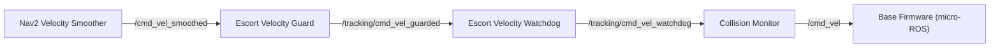
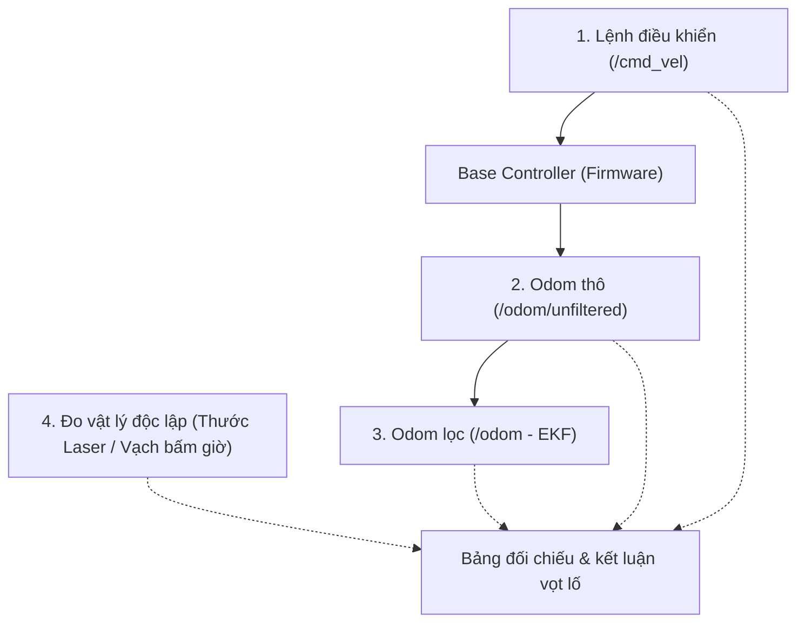

# PERSON TRACKING — CẨM NANG CHUẨN BỊ VÀ NGHIỆM THU PHASE 11
## Hướng Dẫn Vận Hành Phần Cứng Thực Tế: Camera Orbbec Astra & Robot Mecanum

- **Phân hệ:** `person_tracking`
- **Phiên bản:** 1.5 — 24/11/2026 (Dossier Finalized: Strict Preconditions & Sequential Hardware Verification)
- **Trạng thái phân hệ:** **SOFTWARE_READY / HARDWARE_PENDING** (Ca T06: **PARTIAL / CODE_READY**)
- **Mục tiêu:** Cung cấp quy trình kiểm tra từng bước, bộ lệnh tái hiện, bảng tiêu chí Pass/Fail, công cụ chẩn đoán chuyên dụng và phương án đấu nối overlay đã được kiểm chứng sẵn sàng khi kết nối phần cứng thực tế (Camera Orbbec Astra Pro và khung gầm Robot Mecanum Linorobot2).
- **Quy tắc An toàn Cốt lõi (Safety Mandate):**
  > [!IMPORTANT]
  > **TÁCH BIỆT HOÀN TOÀN GIỮA KIỂM TRA TẠI CHỖ VÀ THỬ CHUYỂN ĐỘNG:**
  > 1. Toàn bộ các bước kiểm tra camera Astra, topic ROS, TF, depth registration, thuật toán nhận diện và watchdog phải được thực hiện khi **xe đứng yên hoặc kê 4 bánh xe hổng khỏi sàn (Stationary Bench Testing)**.
  > 2. Thử nghiệm chuyển động chỉ được tiến hành sau khi hoàn thành toàn bộ kiểm tra tĩnh, **ở tốc độ thấp ($v_{x,\max} \le 0.30\text{ m/s}$)**, trong khu vực có kiểm soát, có người giám sát đi kèm và **công tắc E-stop vật lý đã được xác nhận hoạt động**.
  > 3. Tuyệt đối **không tự ý kích hoạt chuyển động** trong lượt chuẩn bị này.

---

## 1. QUY ƯỚC MÔI TRƯỜNG, ROS DOMAIN VÀ PHÂN QUYỀN

### 1.1 Quy ước ROS_DOMAIN_ID
- **Ghép nối hệ thống chính (Main System Integration):** Bắt buộc sử dụng `ROS_DOMAIN_ID=0` (đồng bộ với Voice, Nav2 và Base Controller).
- **Kiểm thử cô lập hoặc chẩn đoán riêng (Isolated Diagnostic Tests):** Sử dụng `ROS_DOMAIN_ID=43` (Perception/ROS runtime) hoặc `ROS_DOMAIN_ID=44` (Gazebo/Simulation baseline).

### 1.2 Phân lập Build Workspace
Luôn build và nạp môi trường phân hệ `person_tracking` cách ly:
```bash
cd /home/ws
source /opt/ros/jazzy/setup.bash
colcon build \
  --packages-select person_tracking \
  --build-base build_tracking \
  --install-base install_tracking \
  --symlink-install
source /home/ws/install_tracking/setup.bash
```

### 1.3 Nguyên tắc Phân quyền Điều khiển & Chuỗi Escort Hoàn chỉnh



- **Voice Agent:** Chủ sở hữu **duy nhất** của Action Client `NavigateToPose`. Phân hệ Tracking tuyệt đối không tạo action client hay phát goal trực tiếp tới Nav2.
- **Tracking Manager:** Bên **duy nhất** cấp `session_id`, xác thực cử chỉ khóa khách và gửi `safety_request` (ABORT/STOP).
- **Velocity Guard & Watchdog:** Cổng an toàn độc lập chốt chặn vận tốc, kẹp cứng $v_y = 0.0000\text{ m/s}$, dập zero ở 20 Hz độc lập khi mất quan sát hoặc mất lệnh.
- **Chuỗi Điều khiển Vận tốc Escort Hoàn chỉnh (Chained Escort Pipeline):**
  $$\text{Nav2 Smoother} \xrightarrow{\text{/cmd\_vel\_smoothed}} \text{Guard} \xrightarrow{\text{/tracking/cmd\_vel\_guarded}} \text{Watchdog} \xrightarrow{\text{/tracking/cmd\_vel\_watchdog}} \text{Collision Monitor} \xrightarrow{\text{/cmd\_vel}} \text{Base}$$
  * **Input của Guard:** Bắt buộc là `/cmd_vel_smoothed` (lệnh vận tốc đã làm mượt từ Nav2).
  * **Output của Guard:** `/tracking/cmd_vel_guarded`.
  * **Input của Watchdog:** `/tracking/cmd_vel_guarded`.
  * **Output của Watchdog:** `/tracking/cmd_vel_watchdog`.
  * **Input của Collision Monitor:** Bắt buộc là `/tracking/cmd_vel_watchdog`.
  * **Output của Collision Monitor:** Topic `/cmd_vel` duy nhất cấp lệnh tới vi điều khiển của khung gầm. Đã được kiểm chứng thực tế: không có publisher nào khác phát vào `/cmd_vel` (docking server đã remap sang `/cmd_vel_docking`).

---

## 2. DANH SÁCH BƯỚC CẦN NGƯỜI DÙNG CÓ MẶT VÀ KẾT NỐI PHẦN CỨNG

Dưới đây là các thao tác vật lý bắt buộc cần sự có mặt của người vận hành:

| STT | Bước thao tác vật lý | Thiết bị liên quan | Mục đích & Lưu ý |
|---|---|---|---|
| **HW-01** | Cắm cáp USB Camera Astra | Orbbec Astra Pro / Máy tính robot | Cắm vào cổng USB 3.0 (màu xanh) để đảm bảo băng thông RGB-D 30 FPS. |
| **HW-02** | Cắm cáp USB Microcontroller | Microcontroller (micro-ROS) | Cắm vào cổng USB của máy tính robot (`/dev/ttyACM0` hoặc `/dev/ttyUSB0`). |
| **HW-03** | Kê kích 4 bánh xe hổng sàn | Khung gầm Mecanum | Kê 4 bánh xe không chạm sàn trong toàn bộ Giai đoạn 1 (Stationary Bench Test). |
| **HW-04** | Kiểm tra công tắc E-Stop vật lý | Nút dừng khẩn cấp vật lý | Nhấn thử E-stop để xác nhận mạch ngắt nguồn động cơ hoạt động ngay lập tức. |
| **HW-05** | Bố trí mốc khoảng cách dán sàn | Thước dây & băng dính sàn | Dán vạch mốc tại $0.5\text{ m}, 1.0\text{ m}, 1.5\text{ m}, 2.0\text{ m}, 2.5\text{ m}, 3.0\text{ m}$ phía sau robot. |
| **HW-06** | Đóng vai hành khách / cắt ngang | Người giám sát & cộng sự | Người A đứng khóa session; Người B đi cắt ngang để kiểm chứng ca T06. |

---

## 3. GIAI ĐOẠN 1: KIỂM TRA TẠI CHỖ KHÔNG CHẠY XE (STATIONARY BENCH TESTING)

### 3.1 Kiểm tra Phần cứng và Driver Camera Astra (3 Bước Độc lập)

Quy trình kiểm tra camera được tách bạch thành 3 bước độc lập rõ ràng:

#### Bước A: Kiểm tra Luồng Dữ liệu (Stream Check)
1. **Xác nhận kết nối thiết bị USB:**
   ```bash
   lsusb | grep -i -E "(orbbec|astra|2bc5)"
   ls -la /dev/video*
   ```
   *Yêu cầu:* Xuất hiện thiết bị UVC Color (`2bc5:0501`) và OpenNI Depth (`2bc5:0403`).
2. **Kiểm tra udev rules:**
   Đảm bảo file `/etc/udev/rules.d/56-orbbec-usb.rules` đã được nạp để cấp quyền truy cập thiết bị không cần root:
   ```bash
   sudo udevadm control --reload-rules && sudo udevadm trigger
   ```
3. **Khởi chạy Astra S Camera Driver (Bật D2C & Đồng bộ màu-độ sâu):**
   ```bash
   export ROS_DOMAIN_ID=0
   source /opt/ros/jazzy/setup.bash
   ros2 launch astra_camera astra.launch.xml depth_registration:=true color_depth_synchronization:=true
   ```
   *(Lưu ý: Benchmark thực tế trên Astra S cho thấy `RELIABLE, KEEP_LAST, VOLATILE, Depth 5` đạt RGB `29.60 FPS`, Depth `29.12 FPS`, age mean `6.71 / 5.60 ms`, max gap `< 80 ms` sau cửa sổ khởi động `> 200 ms`; ngược lại `BEST_EFFORT` rớt frame xuống `15–23 FPS`.)*
4. **Kiểm tra topic, encoding và dải tần số:**
   - Topic Color: `/camera/color/image_raw` (encoding: `rgb8` hoặc `bgr8`, tần số đạt ngưỡng PASS $\ge 20.0\text{ Hz}$, dải danh định phần cứng $20.0 - 30.0\text{ Hz}$).
   - Topic Depth: `/camera/depth/image_raw` (encoding: `16UC1` đơn vị mm hoặc `32FC1`, tần số đạt ngưỡng PASS $\ge 20.0\text{ Hz}$, dải danh định phần cứng $20.0 - 30.0\text{ Hz}$).
   - Topic CameraInfo: `/camera/color/camera_info` (K ma trận hợp lệ, $f_x, f_y, c_x, c_y > 0$).

#### Bước B: Kiểm tra Ghép đôi Thời gian (Timestamp Pairing Check)
Chạy script chẩn đoán tự động trên domain 0:
```bash
export ROS_DOMAIN_ID=0
python3 /home/ws/src/person_tracking/test/check_astra_hardware_topics.py --duration 5.0 --min-rate 20.0 --qos-reliability reliable --qos-depth 5
```
- **Bộ ngưỡng chẩn đoán chuẩn hóa:**
  * **Tần số tối thiểu (Minimum PASS Rate):** $\ge 20.0\text{ Hz}$ cho cả RGB và Depth (dải danh định kỳ vọng của phần cứng Astra Pro là $20.0 - 30.0\text{ Hz}$; cấu hình driver mặc định 30 FPS).
  * **Chênh lệch timestamp ghép đôi (1-to-1 Matching Slop):** Độ lệch thời gian giữa RGB và Depth bắt buộc đạt $\Delta t = |t_{\text{rgb}} - t_{\text{depth}}| \le 0.060\text{ s}$ ($60\text{ ms}$). Thuật toán sử dụng cơ chế sắp xếp độ lệch toàn cục (globally sorted delta matching) để ưu tiên ghép cặp sát thời điểm nhất ($\sim 1.5\text{ ms}$) và chống trôi lệch off-by-one.
  * **Tỷ lệ ghép đôi thành công:** Tối thiểu $\ge 85\%$ số khung hình trong cửa sổ đo phải ghép cặp hợp lệ.
  * **Độ tuổi frame (Frame Age) & Clock Validation:** Frame đến không bị trễ đọng buffer ($t_{\text{ref}} - t_{\text{stamp}} \le 0.400\text{ s}$ hay $400\text{ ms}$), không nằm ở tương lai ($> -0.050\text{ s}$), không lệch clock domain, và timestamp không được ở trạng thái chưa khởi tạo (`sec=0, nanosec=0`).
- **Ý nghĩa Kỹ thuật Quan trọng của Trạng thái PASS từ Probe:**
  > [!IMPORTANT]
  > **Ý NGHĨA TRẠNG THÁI PASS CỦA PROBE CHẨN ĐOÁN:**  
  > Kết quả **PASS** của script `check_astra_hardware_topics.py` **CHỈ XÁC NHẬN** rằng luồng stream RGB/Depth/CameraInfo đang đến ổn định, tần số đạt chuẩn $\ge 20.0\text{ Hz}$ và timestamp được đồng bộ trong cửa sổ đo đạc của probe.  
  > Trạng thái PASS này **TUYỆT ĐỐI KHÔNG THAY THẾ** cho bằng chứng căn chỉnh hình học 3D Depth-to-Color (D2C) thực tế trên RViz2 hoặc phép đo kiểm cự ly trên mốc dán sàn vật lý (Bước C).  
  > Chừng nào chưa có bằng chứng D2C và mốc sàn vật lý, hệ thống vẫn duy trì cơ chế fail-closed `UNVERIFIED_ALIGNMENT` và kẹp cứng vận tốc $0.0000\text{ m/s}$.

#### Bước C: Chứng minh Căn chỉnh Phần cứng D2C (Hardware Depth Registration Proof)
- Xác nhận chế độ đăng ký phần cứng Depth-to-Color (D2C) đang hoạt động trong driver Astra (`depth_registration:=true`).
- Kiểm tra point cloud tại `/camera/depth_registered/points` hoặc lớp phủ RGB-D: biên dạng độ sâu phải trùng khớp hình dạng màu sắc của vật thể, không bị bóng mờ hay lệch pha.

---

### 3.2 Quy ước Hệ Tọa độ Quang học (ADR-10), TF Tree & Gating An toàn Fail-Closed

#### 1. Hệ Tọa độ Quang học và Chiều Camera per ADR-10
Camera Orbbec Astra Pro được lắp ở đuôi xe hướng về phía sau ($x < 0$ so với tâm robot `base_link`, góc quay $yaw \approx 180^\circ$ hay $\pi\text{ rad}$).

> [!NOTE]
> **Quy ước Hệ Tọa độ Quang học Chuẩn (Optical Convention per ADR-10):**
> Tên frame quang học chuẩn: `camera_color_optical_frame` (khác với link vật lý `camera_link`).
> - **Trục $+Z_{\text{opt}}$:** Hướng dọc theo trục quang học thẳng ra ngoài ống kính. Vì camera quay ra sau xe, $+Z_{\text{opt}}$ hướng ngược chiều tiến của robot (tương ứng $-X_{\text{base}}$).
> - **Trục $+X_{\text{opt}}$:** Hướng sang bên phải của mặt phẳng ảnh (tương ứng $+Y_{\text{base}}$, tức hướng sang bên trái của robot khi nhìn xuôi).
> - **Trục $+Y_{\text{opt}}$:** Hướng chúi xuống dưới đáy của mặt phẳng ảnh (tương ứng $-Z_{\text{base}}$, tức hướng thẳng xuống mặt sàn).

#### 2. Kiểm tra TF Tree
Chạy lệnh kiểm tra tính liên tục và đúng đắn của TF tree:
```bash
ros2 run tf2_ros tf2_echo base_link camera_link
ros2 run tf2_ros tf2_echo camera_link camera_color_optical_frame
```
*Yêu cầu:* TF tree liên tục, không đứt đoạn, frame_id quang học đúng chuẩn `camera_color_optical_frame`.

#### 3. Điểm Cần Xác Minh Khi Có Astra: Căn Chỉnh D2C & Cơ Chế Fail-Closed `UNVERIFIED_ALIGNMENT`

> [!IMPORTANT]
> **CƠ CHẾ XỬ LÝ `UNVERIFIED_ALIGNMENT` HIỆN TẠI VÀ CHÍNH SÁCH AN TOÀN FAIL-CLOSED:**
> - Node `person_detector_node` và adapter `LiveAstraAdapter` mặc định thiết lập:
>   `self.require_hardware_alignment_proof = True` (gán cứng trong mã nguồn adapter).
> - **Hiện trạng xử lý khi chưa có camera thật:**
>   Khi khởi chạy với luồng camera thật nhưng chưa xác nhận được cờ đăng ký phần cứng từ driver, pipeline xuất bản tin `/tracking/observation` với telemetry chẩn đoán:
>   * `data_quality: "UNVERIFIED_ALIGNMENT"`
>   * `is_metric_valid: false`
>   * `candidates[i]["depth_valid"]: false`
>   * `candidates[i]["depth_proven"]: false`
> - **Lưu ý đặc biệt về trường `torso_depth_m` khi `depth_valid=false`:**
>   Nếu `depth_valid=false` (do trạng thái `UNVERIFIED_ALIGNMENT`), trường `torso_depth_m` trong bản tin `/tracking/observation` **chỉ đóng vai trò chẩn đoán tham khảo (diagnostic-only)**, tuyệt đối không được dùng làm số đo nghiệm thu cự ly. Chỉ khi căn chỉnh D2C phần cứng được chứng minh và `depth_valid=true`, giá trị độ sâu mới được coi là số đo hợp lệ.
> - **Phản ứng Fail-Closed của Velocity Guard:**
>   Velocity Guard đối chiếu chặt chẽ telemetry này và đánh giá ngay lập tức:
>   $$(False, \text{"DEGRADED_UNVERIFIED_DEPTH"})$$
>   khóa chặt cổng vận tốc, xuất liên tục lệnh dừng $0.0000\text{ m/s}$ ra `/tracking/cmd_vel_guarded`. Xe tuyệt đối không di chuyển khi metric độ sâu chưa được chứng minh căn chỉnh!
> - **Chính sách Không Có Cờ Bypass (No Bypass Flag Policy):**
>   Pipeline phần mềm hiện tại **CHƯA CÓ ĐƯỜNG CẤU HÌNH** (không có tham số ROS hay launch argument nào) để bỏ qua kiểm tra hoặc đưa kết quả xác minh D2C bên ngoài vào pipeline đang chạy. Launch file `perception_pipeline.launch.py` không khai báo đối số `require_hardware_alignment_proof`. Cơ chế an toàn duy trì nguyên tắc fail-closed nghiêm ngặt: tuyệt đối không thêm cờ bỏ qua kiểm tra trong lượt chuẩn bị này.
> - **Đánh dấu bước đưa kết quả xác minh D2C vào pipeline là CÒN CHỜ (PENDING):**
>   Bước cấu hình đưa kết quả xác minh căn chỉnh D2C vào pipeline đang chạy hiện ở trạng thái **CÒN CHỜ (PENDING)**. Do pipeline duy trì fail-closed nghiêm ngặt, việc thiết lập kênh cấu hình này sẽ được thực hiện khi có phần cứng thực tế và sau khi đã hoàn thành các bước đo kiểm tra tĩnh.
> - **Quy trình Đo lường và Thu thập Bằng chứng Căn chỉnh D2C Khi Có Camera Astra:**
>   Khi thiết bị camera Orbbec Astra Pro có mặt, người vận hành thực hiện quy trình thu thập bằng chứng độc lập:
>   1. **Kiểm tra trực quan lớp phủ 3D (Visual 3D Overlay Check):**
>      - Cắm camera, nạp driver với `depth_registration:=true`.
>      - Mở RViz2 hiển thị đồng thời ảnh màu `/camera/color/image_raw` và đám mây điểm `/camera/depth_registered/points`.
>      - Đặt một đối tượng người mẫu đứng trước camera ở cự ly $1.5\text{ m}$.
>      - Xác nhận: Biên dạng đám mây điểm của người phải ôm khít hình khối cơ thể trên ảnh màu; độ lệch mép (edge bleed) sang phông nền phía sau $\le 3\text{ cm}$.
>   2. **Kiểm tra sai số cự ly thực tế trên mốc dán sàn (Ground-Truth Metric Measurement):**
>      - Bố trí các vạch mốc đo dán sàn tại $0.5\text{ m}, 1.0\text{ m}, 1.5\text{ m}, 2.0\text{ m}, 2.5\text{ m}, 3.0\text{ m}$ bằng thước dây tiêu chuẩn.
>      - Sau khi xác nhận đăng ký phần cứng hoạt động và `depth_valid=true`, ghi lại giá trị `torso_depth_m` trích xuất từ `/tracking/observation` so với khoảng cách thực tế đo bằng thước.
>      - Yêu cầu sai số: $\le 5\text{ cm}$ ở cự ly $\le 2.0\text{ m}$, và $\le 10\text{ cm}$ ở cự ly $\le 3.0\text{ m}$ per Bảng C-03.
>   3. **Lưu trữ bằng chứng nghiệm thu (Evidence Artifacts):**
>      - Chụp ảnh màn hình RViz2 hiển thị lớp phủ RGB-D lưu vào `.agent/person_tracking/evidence/phase_11/d2c_rviz2_overlay.png`.
>      - Ghi file log đo cự ly thực tế vào `.agent/person_tracking/evidence/phase_11/d2c_depth_calibration.log`.
>      - Tuyệt đối **không dùng dữ liệu mô phỏng** để xác nhận căn chỉnh phần cứng của camera Astra hay watchdog của firmware.

---

### 3.3 Khởi chạy Perception Pipeline & Profiling Tải Node Thật theo PID
1. **Khởi chạy Pipeline:**
   ```bash
   ros2 launch person_tracking perception_pipeline.launch.py \
     source_mode:=live_astra \
     model_path:=/home/ws/yolo26n-pose.pt \
     device:=cuda:0
   ```
2. **Chạy script Profile PID trong cửa sổ 45s:**
   ```bash
   python3 /home/ws/src/person_tracking/test/profile_detector_pid.py --duration 45 --domain 0
   ```
   *Tiêu chí nghiệm thu:*
   - Đo đúng PID của tiến trình `PersonDetectorNode`.
   - CPU Usage: $\le 45\%$ trên 1 core CPU qua cửa sổ 45s.
   - RAM RSS: $\le 1900\text{ MB}$ (ổn định, không tăng lũy tiến).
   - GPU VRAM: $\le 300\text{ MB}$ (allocated).
   - Thông lượng thực tế qua DDS: $\ge 15.0\text{ FPS}$.
   - Tỷ lệ rơi frame (Dropped Frames): $\le 5.0\%$.

---

### 3.4 Thực thi Ca T06 (Người Đi Cắt Ngang Khách Đang Khóa)
1. **Thiết lập:** Người A đứng tại mốc $1.5\text{ m}$ giơ tay khóa session (`LOCKED_WAIT_DESTINATION`).
2. **Thực hiện cắt ngang:** Người B đi bộ cắt ngang khoảng không giữa camera robot và Người A.
3. **Quan sát telemetry trên `/tracking/observation`:**
   - ByteTrack gán track ID riêng cho Người B ($ID_B \ne ID_A$).
   - Khi Người B che khuất một phần Người A với $\text{IoU} > 0.35$: cờ `is_ambiguous = True` được kích hoạt.
   - Khi Người B đi qua hoàn toàn: cờ `is_ambiguous = False` tự động giải phóng, track $ID_A$ được duy trì ổn định.
   - *Tiêu chí Pass:* **ID Switch = 0**; hệ thống không bị nhảy khóa nhầm sang Người B.

---

### 3.5 Kiểm tra Watchdog Phần cứng trên Đế xe (Base Controller)

> [!WARNING]
> **TRẠNG THÁI: HARDWARE_PENDING (Chưa có mã nguồn/cấu hình firmware vi điều khiển trong repo làm bằng chứng)**  
> Trong repository hiện tại, phân hệ đế xe chỉ chứa package `linorobot2_bringup` khởi chạy tiến trình `micro_ros_agent` kết nối qua cổng nối tiếp `/dev/ttyACM0` ở baud 921600. Toàn bộ mã nguồn firmware của vi điều khiển (MCU như RP2040, Teensy...) và module watchdog phần cứng nằm ngoài repo này.  
> Do đó, các thông số như tên loại vi điều khiển, địa chỉ thanh ghi watchdog, và hằng số ngắt thời gian timeout phần cứng (ước lượng $200 - 500\text{ ms}$) là các giả thiết kỹ thuật bắt buộc phải được kiểm chứng thực tế trên bo mạch. Tuyệt đối không dùng dữ liệu mô phỏng để thay thế cho bằng chứng watchdog firmware.

#### Tách biệt Rạch ròi giữa Thử nghiệm Tĩnh (Bench Test) và Vận hành Dẫn đường (Escort Mode)
1. **Phép thử Bench Test trên Bánh xe Kê hổng:**
   - Khởi chạy micro-ROS agent kết nối với microcontroller:
     ```bash
     ros2 launch linorobot2_bringup bringup.launch.py
     ```
   - Phát lệnh quay thử nghiệm bánh xe dạng xung đơn (one-shot):
     ```bash
     ros2 topic pub --once /cmd_vel geometry_msgs/msg/Twist "{linear: {x: 0.1}, angular: {z: 0.0}}"
     ```
   - Quan sát bánh xe quay và **tự động dừng hẳn** sau khoảng $0.2 - 0.5\text{ s}$.
   - *Mục đích duy nhất:* Xác nhận firmware microcontroller có logic an toàn tự ngắt PWM khi mất kết nối DDS/publisher.
2. **CẢNH BÁO NGUY HIỂM VỀ VẬN HÀNH:**
   - Lệnh `pub --once /cmd_vel` chỉ là một probe chẩn đoán tại bàn bench test.
   - **Tuyệt đối không được phát trực tiếp vào `/cmd_vel` trong chế độ vận hành dẫn đường (Escort Mode)!**
   - Trong chế độ dẫn đường thật, topic `/cmd_vel` được phát **DUY NHẤT** bởi node `collision_monitor` của Nav2, nhận đầu vào an toàn từ chuỗi Guard $\to$ Watchdog.

#### Danh mục các Thao tác Bắt buộc Cần Sự Có Mặt của Người Dùng:
1. Kê kích 4 bánh xe hổng sàn, đảm bảo không có ma sát với mặt đất.
2. Kiểm tra trực tiếp nút E-stop vật lý ngắt nguồn cấp cho mạch driver động cơ.
3. Cắm cáp serial USB nối máy tính robot với bo mạch vi điều khiển (`/dev/ttyACM0`).
4. Quan sát trực tiếp và đo thời gian bánh xe tự dừng quay sau khi lệnh kết thúc.
5. Xác định model vi điều khiển thực tế và kiểm chứng thời gian timeout ngắt phần cứng.

---

## 4. GIAI ĐOẠN 2: THỬ XE TỐC ĐỘ THẤP TẠI KHU VỰC CÓ KIỂM SOÁT (LOW-SPEED MOTION TESTING)

> [!CAUTION]
> **ĐIỀU KIỆN TIÊN QUYẾT BẮT BUỘC TRƯỚC KHI THẢ XE XUỐNG SÀN:**
> 1. Khu vực thử nghiệm: Hành lang hoặc phòng thử nghiệm biệt lập, sàn phẳng sạch, kích thước tối thiểu $10\text{ m} \times 3\text{ m}$, không có vật cản nguy hiểm, không có trẻ em hay người ngoài.
> 2. Đã kiểm tra E-stop vật lý: Nhấn nút E-stop ngắt động cơ tức thì.
> 3. Người giám sát (Supervisor) luôn đi bộ kèm sát cạnh robot trong tầm với tay tới nút E-stop hoặc cầm sẵn remote ngắt khẩn cấp.
> 4. Khóa giới hạn vận tốc an toàn: Thiết lập $v_{x,\max} = 0.30\text{ m/s}$, $\omega_{z,\max} = 0.20\text{ rad/s}$ (đã được xác thực hiệu lực tại Guard và Watchdog).

---

### 4.1 Khởi động Toàn bộ Hệ thống trên `ROS_DOMAIN_ID=0`

> [!WARNING]
> **CẢNH BÁO BLOCKED ĐỐI VỚI `linorobot2_navigation/launch/navigation.launch.py`:**  
> Trong launch file `src/linorobot2/linorobot2_navigation/launch/navigation.launch.py`, đường dẫn cấu hình tham số bị gán cứng:  
> `params_file = PathJoinSubstitution([..., 'config', 'navigation.yaml'])`  
> mà không khai báo `DeclareLaunchArgument('params_file', ...)`.  
> File cấu hình gốc `navigation.yaml` đặt `collision_monitor.cmd_vel_in_topic: "cmd_vel_smoothed"`.  
> **Hậu quả nghiêm trọng:** Nếu chạy trực tiếp `ros2 launch linorobot2_navigation navigation.launch.py`, Collision Monitor sẽ nhận lệnh trực tiếp từ `cmd_vel_smoothed`, **HOÀN TOÀN BỎ QUA** Velocity Guard và Velocity Watchdog!  
> **Yêu cầu đối với maintainer của package `linorobot2_navigation`:** Cần bổ sung `DeclareLaunchArgument('params_file', ...)` vào `navigation.launch.py`.  
> **Giải pháp Overlay của Tracking Đã Triển khai và Kiểm chứng:** Phân hệ `person_tracking` cung cấp launch overlay độc lập:  
> `src/person_tracking/launch/escort_navigation_real.launch.py`  
> nạp trực tiếp `navigation_guard.yaml` (nối Collision Monitor vào `/tracking/cmd_vel_watchdog`), đồng thời tự động nạp `tracking_manager`, `velocity_guard` và `velocity_watchdog`.

#### Hướng dẫn Thiết lập Bản đồ (`map`) và Vị trí Ban đầu (`initial_pose`)
1. **Chính sách Kiểm tra Bản đồ Fail-Closed (Kiểm Tra Điều Kiện Đầu Vào Launch):**
   - Launch file `escort_navigation_real.launch.py` tích hợp bộ kiểm tra tiền điều kiện tự động:
     * **Chế độ Robot Thật (`use_sim_time=false`):**
       - Bắt buộc phải truyền đối số `map:=/path/to/airport_map.yaml` tường minh. Nếu thiếu `map`, launch lập tức ném ngoại lệ dừng khởi động (`RuntimeError: BLOCKED: 'map' argument is mandatory`).
       - Đường dẫn file map bắt buộc phải tồn tại thực tế trên đĩa (`FileNotFoundError` nếu file không tồn tại).
       - Bản đồ mô phỏng (`turtlebot3_world.yaml`) bị **CHẶN HOÀN TOÀN** trên robot thật (`RuntimeError: BLOCKED: Simulation map cannot be used on physical robot`).
     * **Chế độ Mô phỏng / Kiểm thử Cô lập (`use_sim_time=true`):**
       - Cho phép sử dụng fallback mặc định bản đồ `turtlebot3_world.yaml` phục vụ kiểm thử tích hợp.
     * **Bộ Kiểm thử Kiểm tra Điều kiện Đầu vào Launch (6/6 Ca PASS):**
       Đã kiểm chứng 6/6 kịch bản kiểm tra điều kiện đầu vào của launch (thiếu map, sai đường dẫn, dùng nhầm map mô phỏng ở chế độ thật, fallback sim mode, đường dẫn sai ở sim mode, và map hợp lệ) thông qua suite `src/person_tracking/test/test_map_validation.py` (**PASS 100% OK**, log: [.agent/person_tracking/evidence/phase_11/map_validation_tests.log](file:///home/thuytran/ws/src/.agent/person_tracking/evidence/phase_11/map_validation_tests.log)).
     * **Giới hạn kỹ thuật của Ca F:**
       > [!IMPORTANT]
       > **GIỚI HẠN CỦA CA F (KIỂM TRA THAM SỐ ĐẦU VÀO):**  
       > Ca F trong bộ test chỉ kiểm chứng việc vượt qua bộ lọc đường dẫn đầu vào của launch (file tồn tại trên đĩa, không dùng bản đồ mô phỏng). Ca F **CHƯA CHỨNG MINH** rằng `map_server` đã nạp thành công ảnh bản đồ lên costmap hay AMCL đã định vị thành công.
2. **Quy trình Xác nhận Bản đồ & AMCL Định vị Khi Có Map Thật:**
   - **Xác nhận `map_server` nạp ảnh bản đồ thành công:**
     * Kiểm tra topic `/map`: `ros2 topic echo --once /map --field info` $\to$ xác nhận resolution, width, height, origin hợp lệ.
     * Kiểm tra lifecycle của `map_server`: `ros2 lifecycle get /map_server` $\to$ trả về `active [3]`.
   - **Xác nhận thiết lập Initial Pose và AMCL định vị hợp lệ (Localization Valid):**
     * Thiết lập vị trí ban đầu qua cấu hình tĩnh `navigation_guard.yaml` (`amcl.ros__parameters.initial_pose` tọa độ $(-1.0, -0.5, 0.0)$) hoặc phát qua `/initialpose`.
     * Kiểm tra TF liên tục từ `map` tới `odom`: `ros2 run tf2_ros tf2_echo map odom` $\to$ transform tồn tại và cập nhật ổn định.
     * Kiểm tra vị trí AMCL: `ros2 topic echo --once /amcl_pose` $\to$ hiệp phương sai `covariance` nhỏ, không phân kỳ.
     * Kiểm tra phân bố đám mây hạt: quan sát topic `/particlecloud` trên RViz2, các hạt tập trung quanh robot thay vì phân tán toàn bản đồ.

#### Bộ Lệnh Khởi động Chuẩn hóa (5 Terminal):

1. **Terminal 1 — Robot Base & Sensors:**
   ```bash
   export ROS_DOMAIN_ID=0
   source /opt/ros/jazzy/setup.bash
   ros2 launch linorobot2_bringup bringup.launch.py
   ```
2. **Terminal 2 — Astra Camera:**
   ```bash
   export ROS_DOMAIN_ID=0
   source /opt/ros/jazzy/setup.bash
   ros2 launch astra_camera astra_pro.launch.xml depth_registration:=true
   ```
3. **Terminal 3 — Perception Pipeline:**
   ```bash
   export ROS_DOMAIN_ID=0
   source /opt/ros/jazzy/setup.bash
   source /home/ws/install_tracking/setup.bash
   ros2 launch person_tracking perception_pipeline.launch.py source_mode:=live_astra
   ```
4. **Terminal 4 — Escort Navigation Stack (Tracking Overlay Launch):**
   ```bash
   export ROS_DOMAIN_ID=0
   source /opt/ros/jazzy/setup.bash
   source /home/ws/install_tracking/setup.bash
   ros2 launch person_tracking escort_navigation_real.launch.py \
     map:=/path/to/airport_map.yaml \
     use_sim_time:=false \
     max_linear_x:=0.30 \
     max_angular_z:=0.20
   ```
5. **Terminal 5 — Voice Agent Thật:**
   ```bash
   export ROS_DOMAIN_ID=0
   source /opt/ros/jazzy/setup.bash
   ros2 run airport_robot_voice nav_command_node --ros-args -p enable_escort:=true
   ```

---

### 4.2 BƯỚC KIỂM TRA BẮT BUỘC TRƯỚC KHI BẬT ĐỘNG CƠ (PRE-MOTION TOPIC VERIFICATION)

> [!CAUTION]
> **QUY TẮC AN TOÀN BẮT BUỘC TRƯỚC CHUYỂN ĐỘNG:**
> Trước khi bật công tắc nguồn động cơ hoặc kích hoạt bất kỳ chuyển động nào, người vận hành **BẮT BUỘC** phải chạy lệnh kiểm tra đồ thị kết nối của 4 topic vận tốc.
> **Quy tắc này bắt buộc phải thực hiện trong mọi trường hợp, kể cả khi sử dụng `params_file` tùy biến khác với cấu hình mặc định!**

```bash
ros2 topic info -v /cmd_vel_smoothed
ros2 topic info -v /tracking/cmd_vel_guarded
ros2 topic info -v /tracking/cmd_vel_watchdog
ros2 topic info -v /cmd_vel
```

*Bảng Đối Chiếu Kết Nối Đồ Thị Bắt Buộc (Đã xác minh qua log thực tế [escort_real_topic_graph.log](file:///home/thuytran/ws/src/.agent/person_tracking/evidence/phase_11/escort_real_topic_graph.log)):*

| Topic | Publisher Hợp lệ | Subscriber Hợp lệ | Ý nghĩa An toàn |
|---|---|---|---|
| `/cmd_vel_smoothed` | Nav2 `velocity_smoother` | `escort_velocity_guard` | Lệnh thô đã mượt từ Nav2 |
| `/tracking/cmd_vel_guarded` | `escort_velocity_guard` | `escort_velocity_watchdog` | Đã kẹp trần cự ly ($0.30\text{ m/s}, 0.20\text{ rad/s}$) và $v_y = 0.0$ |
| `/tracking/cmd_vel_watchdog` | `escort_velocity_watchdog` | Nav2 `collision_monitor` | Tự động dập zero 20 Hz độc lập khi mất lệnh |
| `/cmd_vel` | Nav2 `collision_monitor` (DUY NHẤT) | Base `micro_ros_agent` | Chốt chặn laser cuối cùng trước khi vào firmware |

> [!CAUTION]
> **NGHIÊM CẤM THẢ XE XUỐNG SÀN NẾU:**
> 1. Topic `/cmd_vel` có bất kỳ publisher nào khác ngoài `collision_monitor`.
> 2. `collision_monitor` đăng ký subscribe trực tiếp vào `/cmd_vel_smoothed` (bỏ qua Guard/Watchdog).
> 3. Bất kỳ topic nào trong 4 topic trên có `Subscription count: 0`.

---

### 4.3 Các Bước Thử nghiệm Vận hành Có Người Giám sát
1. **Thử nghiệm 1 (Khóa và dẫn thẳng tốc độ thấp):**
   - Người giám sát đứng phía sau robot $1.5\text{ m}$, giơ tay $\ge 1.5\text{ s}$.
   - Nghe Voice phát xác nhận khóa thành công (`LOCKED_WAIT_DESTINATION`).
   - Ra lệnh giọng nói tới điểm đến gần (ví dụ "đi quầy thông tin", cự ly $3\text{ m}$).
   - Robot bắt đầu di chuyển về phía trước, người giám sát đi theo sau ở cự ly $1.5\text{ m}$.
   - *Yêu cầu:* Robot giữ vận tốc ổn định trong khoảng $0.20 - 0.30\text{ m/s}$, không giật cục.
2. **Thử nghiệm 2 (Khách tụt lại xa > 2.0m và > 2.5m):**
   - Đang dẫn đường, người giám sát cố tình dừng lại để khoảng cách tăng lên $2.2\text{ m}$, sau đó $> 2.5\text{ m}$.
   - *Yêu cầu:* Khi $> 2.0\text{ m}$, xe giảm tốc độ; khi $> 2.5\text{ m}$, xe dừng hẳn chờ; khi người giám sát bước lại gần $1.5\text{ m}$, xe tự động tiếp tục di chuyển mượt mà (hysteresis).
3. **Thử nghiệm 3 (Khách lệch sang mép ảnh):**
   - Người giám sát bước chếch sang trái/phải mép camera.
   - *Yêu cầu:* Robot điều chỉnh góc quay $\omega_z$ nhẹ hướng tâm để giữ khách trong tầm nhìn, không xoay đột ngột.
4. **Thử nghiệm 4 (Mất khách & Safety Abort):**
   - Người giám sát cố tình bước khuất sau vách tường:
     - Tại $t = 0.38\text{ s}$: Robot dập vận tốc về $0.0000\text{ m/s}$ (`WAITING_FOR_PASSENGER`).
     - Tại $t = 1.20\text{ s}$: Tracking gửi `safety_request` abort $\to$ Voice hủy goal Nav2 $\to$ robot dừng hẳn vĩnh viễn.
     - Người giám sát bước lại vào camera: **Robot tuyệt đối không tự chạy lại**, giữ nguyên trạng thái dừng.
5. **Thử nghiệm 5 (Collision Monitor ưu tiên dập laser):**
   - Đang dẫn đường, một chướng ngại vật xuất hiện phía trước đầu xe trong phạm vi $0.3\text{ m}$.
   - *Yêu cầu:* Collision Monitor lập tức dập `/cmd_vel` về 0, ưu tiên cao hơn lệnh của Guard.

---

## 5. GIAI ĐOẠN 3: ĐỐI CHIẾU ĐA LỚP VẬN TỐC & PHÉP ĐO CHUYỂN ĐỘNG ĐỘC LẬP

Để làm sáng tỏ triệt để hiện tượng vọt lố vận tốc trên `/odom` từng ghi nhận ở mô phỏng, tiến hành đối chiếu đồng thời 4 lớp số liệu:



### 5.1 Bố trí Phép đo Chuyển động Vật lý Độc lập (Independent Ground-Truth)
- **Phương pháp 1 (Vạch đo sàn cố định + Bấm giờ quang/điện tử):**
  - Đánh dấu 2 vạch đo cố định trên sàn cách nhau đúng $S = 3.000\text{ m}$.
  - Ghi lại thời gian robot đi qua giữa 2 vạch bằng đồng hồ bấm giờ độ chính xác cao: $t_{\text{start}}$ và $t_{\text{end}}$.
  - Tính vận tốc trung bình thực tế:
    $$v_{\text{ground\_truth}} = \frac{S}{t_{\text{end}} - t_{\text{start}}}$$
- **Phương pháp 2 (Máy đo khoảng cách Laser - Laser Distance Meter):**
  - Đặt máy đo khoảng cách laser cố định phía sau đuôi robot, nhắm vào mặt phẳng đuôi xe.
  - Ghi nhận độ dịch chuyển thực tế theo thời gian.

### 5.2 Bảng Mẫu Thu Thập và Đối Chiếu Vận Tốc Thực Tế
| Lượt chạy | Lệnh `/cmd_vel` max | Odom thô `/odom/unfiltered` max | Odom lọc `/odom` max | Vận tốc đo độc lập $v_{\text{ground\_truth}}$ | Đánh giá sai số EKF vs Thực tế |
|---|---|---|---|---|---|
| Lượt 1 | ... m/s | ... m/s | ... m/s | ... m/s | ... |
| Lượt 2 | ... m/s | ... m/s | ... m/s | ... m/s | ... |
| Lượt 3 | ... m/s | ... m/s | ... m/s | ... m/s | ... |

*Tiêu chí đánh giá:*
- Nếu $v_{\text{ground\_truth}} \le 0.30\text{ m/s}$ và `/odom/unfiltered` $\le 0.30\text{ m/s}$ trong khi `/odom` vọt lên $> 0.35\text{ m/s}$ $\implies$ Chứng minh thực nghiệm độc lập rằng đỉnh vận tốc là do bộ lọc EKF vọt lố số học, không phải chuyển động thực của robot.

---

## 6. BẢNG TIÊU CHÍ NGHIỆM THU PASS/FAIL PHASE 11 (HARDWARE ACCEPTANCE)

| Mã tiêu chí | Hạng mục kiểm tra | Điều kiện ĐẠT (PASS) | Điều kiện KHÔNG ĐẠT (FAIL) |
|---|---|---|---|
| **C-01** | Astra Stream & Format | Rate $\ge 20.0\text{ Hz}$ (kỳ vọng $20 - 30\text{ Hz}$), depth 16UC1/32FC1, RGB rgb8/bgr8, $\Delta t \le 0.060\text{ s}$, age $\le 0.400\text{ s}$, stamp/clock hợp lệ | Mất stream, rate $< 20.0\text{ Hz}$, sai encoding, $\Delta t > 0.060\text{ s}$, age $> 0.400\text{ s}$, stamp = 0 hoặc lệch clock |
| **C-02** | D2C Hardware Alignment | Depth khớp hoàn toàn RGB, biên dạng vật thể không lệch | Biên dạng người bị bóng mờ hoặc lệch pha $> 5\text{ cm}$ |
| **C-03** | Sai số cự ly mốc thật | Sai số $\le 3\%$ ở $1.0 - 2.0\text{ m}$; $\le 5\%$ ở $2.0 - 2.5\text{ m}$ | Sai số $> 5\%$ trong phạm vi dẫn đường danh định |
| **C-04** | Tải CPU/RAM/VRAM PID thật | Throughput $\ge 15\text{ FPS}$, CPU $\le 45\%$, RAM $\le 1900\text{ MB}$ | Treo node, RAM tăng liên tục, throughput $< 10\text{ FPS}$ |
| **C-05** | Ca T06 Người cắt ngang | Giữ nguyên track ID Người A khi Người B cắt ngang (ID switch = 0) | Nhảy khóa sang Người B hoặc mất phiên vĩnh viễn |
| **C-06** | Watchdog phần cứng base | Bánh xe tự dừng quay trong $0.2 - 0.5\text{ s}$ khi ngắt lệnh `/cmd_vel` | Bánh xe tiếp tục quay không kiểm soát khi mất lệnh |
| **C-07** | Bám đuôi tốc độ thấp | Robot di chuyển mượt mà ở cự ly $1.5\text{ m}$, $v_x \le 0.30\text{ m/s}$ | Chạy giật cục, vọt tốc $> 0.30\text{ m/s}$ hoặc trôi ngang |
| **C-08** | Khoảng cách & Mép ảnh | Tụt $> 2.5\text{ m}$ xe dừng chờ; mép ảnh xe xoay chỉnh hướng tâm | Không dừng khi khách tụt lại, quay sai chiều |
| **C-09** | Mất khách & Safety Abort | Dập zero trong $0.4\text{ s}$, abort trong $1.2\text{ s}$, không tự chạy lại | Xe tiếp tục chạy khi mất người, tự chạy lại sau abort |
| **C-10** | E-Stop & Collision Stop | Nhấn E-stop hoặc laser cản $0.25\text{ m}$ $\to$ xe dừng lập tức | Xe không dừng khi bấm E-stop hoặc có cản trước đầu |

---

## 6.1 KẾT QUẢ KIỂM CHỨNG PHẦN MỀM & XÁC THỰC LAUNCH OVERLAY THẬT (24/11/2026)

Toàn bộ chuỗi bàn giao phần mềm giữa Voice, Tracking Manager, Velocity Guard, Watchdog và Nav2 đã được kiểm chứng qua hai bộ bài test độc lập:

### A. Nghiệm thu Trực tiếp `escort_navigation_real.launch.py` với Gazebo Base Cô lập (`ROS_DOMAIN_ID=44`)
- **Môi trường tách biệt:**
  * Khung gầm, `/scan`, `/odom`, TF và `/clock` do `gazebo_sim_base.launch.py` cấp (không chạy Nav2/Guard/Watchdog).
  * Toàn bộ Nav2 và chuỗi an toàn do chính `escort_navigation_real.launch.py` cấp (`use_sim_time:=true`).
  * Sử dụng Voice node thật (`enable_escort:=true`) và observation giả lập COCO 17-keypoint.
- **Bộ runner & test suite:**
  * Runner: `src/person_tracking/test/execute_escort_real_verification.sh`
  * Script kiểm chứng: `src/person_tracking/test/verify_escort_real_launch.py`
  * Log tổng kết: [.agent/person_tracking/evidence/phase_11/escort_real_smoke.log](file:///home/thuytran/ws/src/.agent/person_tracking/evidence/phase_11/escort_real_smoke.log)
  * Log topic graph: [.agent/person_tracking/evidence/phase_11/escort_real_topic_graph.log](file:///home/thuytran/ws/src/.agent/person_tracking/evidence/phase_11/escort_real_topic_graph.log)
  * Log tham số runtime: [.agent/person_tracking/evidence/phase_11/escort_real_params.log](file:///home/thuytran/ws/src/.agent/person_tracking/evidence/phase_11/escort_real_params.log)
- **Kết quả nghiệm thu thực tế (100% PASS, Exit Code = 0):**
  1. **Audit Topic Graph & Publisher /cmd_vel:**
     - Duy nhất node `collision_monitor` phát ra `/cmd_vel` (`Publisher count: 1`).
     - Topic `/cmd_vel_docking` được remap cô lập (`docking_server` không đè lên `/cmd_vel`). Không có teleop hay publisher trái phép nào $\implies$ **PASSED [OK]**.
  2. **Xác minh Tham số Runtime tại Guard và Watchdog:**
     - `Guard`: $v_{x,\max} = 0.30\text{ m/s}$, $\omega_{z,\max} = 0.20\text{ rad/s}$.
     - `Watchdog`: $v_{x,\max} = 0.30\text{ m/s}$, $\omega_{z,\max} = 0.20\text{ rad/s}$ $\implies$ **PASSED [OK]**.
  3. **Case 1 (Chặn dispatch trước khóa):**
     - Voice từ chối khi chưa khóa (`NO_SESSION_ID`), `dispatched=0, nav_started=0, rejected=True, robot_still=True` $\implies$ **PASSED [OK]**.
  4. **Case 2 (Khóa hợp lệ & Xe di chuyển):**
     - Khóa session thành công (`locked_session_id=a547d562-0963-45ee-8e39-dcf6e89ec978`), Voice dispatch goal tới Nav2.
     - Thu nhận định danh goal active: `session_id=a547d562-0963-45ee-8e39-dcf6e89ec978`, `goal_attempt_id=att_1795530139687_1`, `nav2_uuid=f2867135425f48c49efc2c37f0e1d2e5`.
     - Robot dịch chuyển vật lý trong Gazebo ($d = 0.077\text{ m} > 0.05\text{ m}$, $v_{x,\max} = 0.300\text{ m/s}$ kẹp chuẩn trần) $\implies$ **PASSED [OK]**.
  5. **Case 3 (Mất khách & Hủy goal Nav2 đối chiếu 3 định danh & Dừng 3 trục odom):**
     - Ngừng observation: Guard dập zero sau **$0.482\text{ s}$** ($\le 0.65\text{ s}$), Tracking Manager phát abort sau **$1.226\text{ s}$** ($\le 2.20\text{ s}$).
     - Voice nhận abort gọi `cancel_goal_async`, Nav2 trả `CANCELED`.
     - **Đối chiếu khớp hoàn toàn cả 3 định danh giữa dispatch và cancel:**
       * `match_session = True` (`a547d562-0963-45ee-8e39-dcf6e89ec978`)
       * `match_attempt = True` (`att_1795530139687_1`)
       * `match_uuid = True` (`f2867135425f48c49efc2c37f0e1d2e5`)
     - **Xác nhận Dừng Xe Đủ 3 Bậc Tự Do (3-Axis Motion Stoppage Evaluation):**
       - Cửa sổ đo được lấy từ **20 mẫu odom cuối cùng** (`recent_samples = node.odom_history[-20:]`) sau khi Voice hủy goal Nav2 và sau độ trễ 1.0s.
       - Kiểm tra độ giãn thời gian (span) của cửa sổ dựa theo **header timestamp** của mẫu đầu và mẫu cuối:
         $$t_{\text{span}} = t_{\text{recent\_samples}[-1]} - t_{\text{recent\_samples}[0]} = 0.380\text{ s} \ge 0.35\text{ s}$$
       - Toàn bộ 20 mẫu trong cửa sổ đạt tiêu chí đứng yên trên cả 3 trục:
         * $|v_x| < 0.02\text{ m/s}$ (cực đại $= 0.0000\text{ m/s}$) $\implies$ ĐẠT.
         * $|v_y| < 0.02\text{ m/s}$ (cực đại $= 0.0000\text{ m/s}$) $\implies$ ĐẠT.
         * $|\omega_z| < 0.02\text{ rad/s}$ (cực đại $= 0.0000\text{ rad/s}$) $\implies$ ĐẠT.
       - **Lưu ý chính xác về bằng chứng:** Phép đo xác nhận 20 mẫu odom cuối cùng nằm trong ngưỡng dừng và kiểm span theo header stamp ($0.380\text{ s}$). Phép đo này **không ghi nhận/xác minh từng mẫu odom đến liên tục sau mốc dập zero dừng xe**; việc theo dõi dòng odom liên tục từng frame từ thời điểm dừng sẽ được kiểm chứng chi tiết trên xe thật cùng thiết bị đo vật lý độc lập.
       - `stopped_3axis = True`, FSM trở về `IDLE` $\implies$ **PASSED [OK]**.

### B. Bộ Log Hồi Quy (Regression Logs) của Launch Gazebo Cũ
> [!NOTE]
> **ĐÍNH CHÍNH VỀ BỘ LOG HỒI QUY CŨ:**
> Bộ log kiểm thử thông luồng trước đó từ `gazebo_escort_integration.launch.py` được lưu giữ đầy đủ dưới nhãn **HỒI QUY (REGRESSION)**. Cần lưu ý rằng phép đo dừng xe trong bộ log cũ này chỉ theo dõi duy nhất thành phần $v_x$ trên 20 mẫu odom, chưa kiểm tra toàn diện cả 3 trục $v_x, v_y, \omega_z$ như bộ kiểm chứng mới `verify_escort_real_launch.py`.
- Log tổng kết hồi quy: [.agent/person_tracking/evidence/phase_11/phase11_software_smoke.log](file:///home/thuytran/ws/src/.agent/person_tracking/evidence/phase_11/phase11_software_smoke.log)
- Log runtime Gazebo/Nav2 cũ: [.agent/person_tracking/evidence/phase_11/gazebo_smoke_runtime.log](file:///home/thuytran/ws/src/.agent/person_tracking/evidence/phase_11/gazebo_smoke_runtime.log)
- Log runtime Voice cũ: [.agent/person_tracking/evidence/phase_11/voice_smoke_node.log](file:///home/thuytran/ws/src/.agent/person_tracking/evidence/phase_11/voice_smoke_node.log)

---

## 7. DANH SÁCH PHÉP ĐO CÒN CHỜ (PENDING MEASUREMENTS)
Cho tới thời điểm người dùng kết nối thiết bị và chạy các bước trên, các phép đo sau đây được ghi nhận ở trạng thái **CHỜ ĐO TRÊN PHẦN CỨNG THỰC TẾ (PENDING HARDWARE MEASUREMENT)**:
1. Thông số nhiễu và độ lệch thực tế của camera Orbbec Astra Pro (FPS thật, dropout rate và profile CPU/VRAM theo PID liên tục).
2. Sai số cự ly thực tế trên các mốc khoảng cách dán sàn ($0.5\text{ m} - 3.0\text{ m}$) và chứng minh căn chỉnh D2C.
3. Đo kiểm nghiệm thu ca T06 với video hành khách thật tại hiện trường.
4. Thông số timeout watchdog phần cứng thực tế trên mạch microcontroller của đế xe.
5. Dữ liệu đối chiếu đồng thời giữa `/cmd_vel`, `/odom/unfiltered`, `/odom` và vận tốc đo độc lập $v_{\text{ground\_truth}}$.

---

## 8. CHECKLIST TUẦN TỰ CHO NGƯỜI DÙNG KHI CÓ PHẦN CỨNG TẠI HIỆN TRƯỜNG

Khi nhận phần cứng (Camera Astra Pro và Khung gầm Linorobot2), người vận hành thực hiện theo **ĐÚNG 5 GIAI ĐOẠN TUẦN TỰ** sau:

### Giai đoạn 1: Kiểm tra Stream & TF Camera Astra (Stationary Bench Test)
- [ ] **Kê bánh an toàn:** Đặt robot lên bệ kê kích, đảm bảo 4 bánh xe hoàn toàn hổng khỏi mặt đất; cắm cáp USB camera Astra vào cổng USB 3.0.
- [ ] **Khởi chạy driver:** Nạp udev rules và chạy driver `astra_pro.launch.xml depth_registration:=true` trên `ROS_DOMAIN_ID=0`.
- [ ] **Kiểm tra luồng dữ liệu (Lệnh đầu tiên khi có Astra):** Chạy `export ROS_DOMAIN_ID=0 && python3 /home/ws/src/person_tracking/test/check_astra_hardware_topics.py --duration 5.0 --min-rate 20.0` xác nhận:
  * Topic Color `/camera/color/image_raw` và Depth `/camera/depth/image_raw` đạt tần số $\ge 20.0\text{ Hz}$ (dải danh định kỳ vọng của phần cứng là $20.0 - 30.0\text{ Hz}$).
  * Chênh lệch ghép đôi timestamp: $\Delta t = |t_{\text{rgb}} - t_{\text{depth}}| \le 0.060\text{ s}$, tỷ lệ ghép đôi $\ge 85\%$, độ tuổi frame $\le 0.400\text{ s}$, clock domain đồng bộ và timestamp hợp lệ.
  * *Lưu ý ý nghĩa PASS:* Probe chỉ xác nhận luồng stream và timestamp; chưa thay thế cho căn chỉnh D2C 3D hay kiểm tra mốc cự ly sàn. Hệ thống duy trì fail-closed `UNVERIFIED_ALIGNMENT` ($0.0000\text{ m/s}$) cho tới khi có bằng chứng D2C thật.
- [ ] **Kiểm tra TF Tree:** Chạy `ros2 run tf2_ros tf2_echo base_link camera_color_optical_frame` xác nhận frame quang học liên tục per ADR-10.

### Giai đoạn 2: Đo Căn chỉnh D2C và Cự ly Mốc Thực tế (Calibration & Metrics)
- [ ] **Kiểm tra trực quan lớp phủ 3D (Visual D2C Check):**
  * Mở RViz2 hiển thị đồng thời `/camera/color/image_raw` và `/camera/depth_registered/points`.
  * Người mẫu đứng tại cự ly $1.5\text{ m}$; xác nhận point cloud ôm khít biên dạng cơ thể trên ảnh màu, độ lệch mép (edge bleed) $\le 3\text{ cm}$.
  * Chụp ảnh màn hình lưu vào `.agent/person_tracking/evidence/phase_11/d2c_rviz2_overlay.png`.
- [ ] **Đo cự ly trên mốc dán sàn ($0.5\text{ m} - 3.0\text{ m}$):**
  * Dán vạch sàn tại các mốc $0.5\text{ m}, 1.0\text{ m}, 1.5\text{ m}, 2.0\text{ m}, 2.5\text{ m}, 3.0\text{ m}$ phía sau robot.
  * **Lưu ý về telemetry:** Khi `depth_valid=false`, trường `torso_depth_m` chỉ dùng để chẩn đoán, không dùng làm số đo nghiệm thu. Chỉ đo đạc nghiệm thu khi đã có bằng chứng D2C hợp lệ và `depth_valid=true`. Ghi file log đo cự ly vào `.agent/person_tracking/evidence/phase_11/d2c_depth_calibration.log`.
- [ ] **Ghi nhận bước đưa kết quả vào pipeline:** Đánh dấu bước cấu hình đưa chứng minh D2C vào pipeline là **CÒN CHỜ (PENDING)**; duy trì fail-closed và không dùng cờ bypass.
- [ ] **Profiling PID & Test Ca T06:** Chạy `profile_detector_pid.py` trong 45s (CPU $\le 45\%$, RAM $\le 1900\text{ MB}$, throughput $\ge 15\text{ FPS}$) và thử nghiệm người cắt ngang (T06: ID switch = 0).

### Giai đoạn 3: Kiểm tra Watchdog Firmware Đế xe (Base Controller Bench Test)
- [ ] **Xác nhận nút E-stop vật lý:** Ấn thử nút E-stop vật lý để đảm bảo mạch ngắt nguồn động cơ hoạt động tức thì.
- [ ] **Cắm cáp nối tiếp:** Cắm cáp USB vi điều khiển vào cổng `/dev/ttyACM0` (baud 921600).
- [ ] **Khởi chạy base:** Chạy `ros2 launch linorobot2_bringup bringup.launch.py`.
- [ ] **Bench probe ngắt lệnh:** Gửi lệnh xung đơn:
  `ros2 topic pub --once /cmd_vel geometry_msgs/msg/Twist "{linear: {x: 0.1}, angular: {z: 0.0}}"`
- [ ] **Xác nhận bánh tự dừng:** Quan sát bánh xe quay và tự động ngắt PWM sau $0.2 - 0.5\text{ s}$ khi mất lệnh. Ghi nhận thông số watchdog phần cứng thực tế.

### Giai đoạn 4: Xác nhận Bản đồ (`map_server`/AMCL) & Chuỗi Topic Vận tốc
- [ ] **Khởi chạy Escort Navigation Overlay:** Chạy `ros2 launch person_tracking escort_navigation_real.launch.py map:=/path/to/airport_map.yaml use_sim_time:=false max_linear_x:=0.30 max_angular_z:=0.20` trên `ROS_DOMAIN_ID=0`.
- [ ] **Xác nhận bản đồ đã nạp:**
  * Kiểm tra dữ liệu bản đồ: `ros2 topic echo --once /map --field info` xác nhận metadata hợp lệ.
  * Kiểm tra lifecycle map_server: `ros2 lifecycle get /map_server` $\to$ trả về `active [3]`.
- [ ] **Xác nhận Initial Pose và AMCL định vị:**
  * Thiết lập initial pose (khớp tọa độ cấu hình hoặc qua `/initialpose`).
  * Kiểm tra TF liên tục: `ros2 run tf2_ros tf2_echo map odom`.
  * Kiểm tra vị trí và hội tụ hạt: `ros2 topic echo --once /amcl_pose` (covariance nhỏ) và quan sát `/particlecloud` trên RViz2.
- [ ] **Kiểm tra đồ thị 4 topic vận tốc (Pre-Motion Topic Verification):**
  * Chạy `ros2 topic info -v` trên cả 4 topic: `/cmd_vel_smoothed`, `/tracking/cmd_vel_guarded`, `/tracking/cmd_vel_watchdog`, `/cmd_vel`.
  * **Bắt buộc:** Xác nhận duy nhất node `collision_monitor` phát ra `/cmd_vel`, không có bypass, **kể cả khi sử dụng `params_file` tùy biến khác với mặc định**.

### Giai đoạn 5: Thử nghiệm Chuyển động Tốc độ Thấp Có Người Giám sát
- [ ] **Hạ xe an toàn:** Hạ xe xuống sàn phẳng tại khu vực thử nghiệm có rào chắn, không chướng ngại vật nguy hiểm.
- [ ] **Người giám sát sẵn sàng:** Người giám sát luôn đi bộ sát cạnh robot, tay sẵn sàng nút E-stop vật lý hoặc remote ngắt nguồn.
- [ ] **Khởi chạy Voice Agent:** Chạy `ros2 run airport_robot_voice nav_command_node --ros-args -p enable_escort:=true`.
- [ ] **Thực hiện 5 kịch bản escort tốc độ thấp ($v_{x,\max} \le 0.30\text{ m/s}$, $\omega_{z,\max} \le 0.20\text{ rad/s}$):**
  1. Dẫn thẳng tốc độ thấp ($1.5\text{ m}$, robot chạy mượt mà $0.20 - 0.30\text{ m/s}$).
  2. Khách tụt lại xa ($> 2.0\text{ m}$ giảm tốc, $> 2.5\text{ m}$ dừng chờ, bước lại gần tự chạy tiếp).
  3. Khách lệch mép ảnh (robot xoay nhẹ hướng tâm giữ khách trong tầm nhìn).
  4. Mất khách (dập zero sau $\le 0.65\text{ s}$, abort sau $\le 2.20\text{ s}$, Voice hủy goal Nav2, robot dừng hẳn vĩnh viễn, không tự chạy lại).
  5. Collision Monitor dập laser (vật cản $0.25\text{ m}$ phía trước xe $\to$ dừng tức thì).
- [ ] **Thu thập số liệu đối chiếu 4 lớp vận tốc:** Ghi nhận bảng đối chiếu `/cmd_vel`, `/odom/unfiltered`, `/odom` và vận tốc đo vật lý độc lập $v_{\text{ground\_truth}}$.
