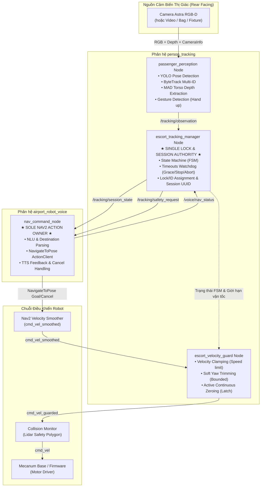

# PHÂN HỆ PERSON TRACKING — ĐẶC TẢ KỸ THUẬT HỆ THỐNG (PROJECT SPECIFICATION)

**Dự án:** Robot dẫn đường hành khách sân bay (Airport Escort Robot)  
**Phân hệ:** `person_tracking`  
**Nền tảng thực thi:** ROS 2 Jazzy Jalisco (Ubuntu 24.04 Noble LTS, Python 3.12 trong VS Code Dev Container)  
**Khung gầm:** Robot Mecanum Linorobot2  
**Cảm biến thị giác:** Camera Astra RGB-D gắn cố định hướng về phía sau robot  
**Phiên bản tài liệu:** 1.0 — 23/11/2026 (Phase 1)  
**Baseline Git Commit:** `78ae0e51bdcbe4db4d536e96fa17a2d7ae8f9794`  

---

## 1. Bối cảnh Nghiệp vụ và Mục tiêu Vận hành

### 1.1. Nghiệp vụ Dẫn đường Sân bay
- Robot hoạt động như một trợ lý dẫn đường cá nhân tại nhà ga sân bay.
- **Quy tắc di chuyển:** Robot đi phía trước mở đường bám theo lộ trình do Nav2 tính toán; hành khách đi theo sau robot.
- **Camera quan sát:** Camera Astra RGB-D được gắn cố định ở đuôi xe, hướng vuông góc về phía sau (`yaw = pi` so với `base_link`) để liên tục quan sát hành khách đi kèm.
- **Trạng thái khởi đầu (IDLE):** Robot đứng yên tại chỗ. Camera liên tục phát hiện nhiều người trong tầm nhìn và nhận diện cử chỉ giơ một tay.
- **Khóa mục tiêu (LOCKED):** Khi có hành khách giơ một tay giữ liên tục trong thời gian cấu hình (`raise_hand_hold_sec = 1.5s`), hệ thống chọn người hợp lệ gần nhất để khóa. Khóa xong, hành khách có thể hạ tay xuống, robot vẫn đứng yên chờ hành khách nói điểm đến.
- **Bắt đầu dẫn đường:** Phân hệ Voice (`airport_robot_voice`) nhận diện điểm đến bằng giọng nói, kiểm tra cờ khóa của Tracking; nếu hợp lệ, Voice gửi Goal điều hướng cho Nav2 và robot bắt đầu lăn bánh dẫn đường.
- **Trong hành trình:**
  - Robot giữ hành khách trong khung nhìn camera sau.
  - Nếu khách tụt lại phía sau: Robot tự động giảm tốc độ tịnh tiến hoặc dừng chờ.
  - Nếu khách đi gần lại: Robot không chủ động lùi hoặc tăng tốc vượt Nav2.
  - Nếu khách lệch sang mép ảnh: Robot hiệu chỉnh góc quay (`angular.z`) nhẹ có giới hạn để đưa khách về trung tâm tầm nhìn.
- **Kết thúc hành trình (ARRIVED):** Khi Nav2 đưa robot tới đích thành công, Voice thông báo hoàn tất; Tracking xóa phiên, xóa ID khóa, trở về `IDLE`.
- **Mất khách / Hủy hành trình (ABORT):** Nếu mất dấu khách quá thời hạn an toàn (`visibility_abort_sec = 1.2s`), Tracking lập tức ép vận tốc về 0, gửi yêu cầu hủy cho Voice, dọn dẹp phiên và ngăn robot tự chạy lại.

---

## 2. Truy vết Quyết định của Chủ dự án (Traceability Matrix: D01–D12)

| Mã | Quyết định bắt buộc | Giải pháp thiết kế & Hiện thực kỹ thuật trong Tracking |
|---|---|---|
| **D01** | Chỉ làm việc trong workspace `ws`; không truy cập `~/ros2_ws`. | Tuyệt đối tuân thủ đường dẫn canonical `/home/thuytran/ws` (host) và `/home/ws` (container). Không tham chiếu bất kỳ đường dẫn nào ngoài workspace. |
| **D02** | Giữ nguyên Gazebo, URDF/xacro, plugin và camera mô phỏng. | Không chỉnh sửa file nào trong `linorobot2_gazebo`, `linorobot2_description`. Sử dụng video RGB thực tế, synthetic depth fixtures và fake observation generator cho kiểm thử perception; chỉ dùng Gazebo sẵn có để kiểm tra động học chuyển động. |
| **D03** | Không có camera Astra thật tại nơi phát triển hiện tại. | Thiết kế cấu trúc Adapter đa nguồn (`live_astra`, `bag_replay`, `video_fixture`, `fake_ros`). Đánh dấu trạng thái `HARDWARE_VALIDATION_PENDING` cho tới Phase 11. |
| **D04** | `airport_robot_voice` phát triển song song trong conversation khác. | Không sửa code voice. Phối hợp qua bản hợp đồng [INTERFACES.md](file:///home/thuytran/ws/src/.agent/person_tracking/INTERFACES.md) và tài liệu yêu cầu tích hợp [VOICE_INTEGRATION_REQUEST.md](file:///home/thuytran/ws/src/.agent/person_tracking/VOICE_INTEGRATION_REQUEST.md). Dùng `mock_voice_owner` cho kiểm thử nội bộ. |
| **D05** | Voice sở hữu duy nhất Nav2 goal/action; Tracking không gọi trực tiếp `NavigateToPose`. | Tracking chỉ quản lý FSM và cổng an toàn vận tốc (`escort_velocity_guard`). Guard có khả năng ép 0 vận tốc tức thì độc lập, không phụ thuộc vào việc voice đã hủy goal xong hay chưa. |
| **D06** | Khi đến đích thành công, xóa khóa ID và đích, trở về `IDLE`. | Khi nhận sự kiện `GOAL_SUCCEEDED` đúng `session_id`, FSM chuyển sang `ARRIVED`, xóa `selected_id`, reset bộ đếm, đưa guard về 0 và chuyển về `IDLE`. Không tái sử dụng khách cũ. |
| **D07** | Nhiều người cùng giơ tay hợp lệ: ưu tiên người gần camera nhất. | So sánh khoảng cách depth có kiểm chứng (`torso_depth_m`); chọn người có cự ly nhỏ nhất. Nếu thiếu depth, dùng diện tích bbox làm proxy có gắn cờ giảm độ tin cậy; nếu chênh lệch <15% thì báo `AMBIGUOUS_GESTURE` và không khóa tùy tiện. |
| **D08** | Mất người trong vài frame không coi là mất vĩnh viễn (Grace period). | Cấu hình bộ đếm: `perception_grace_sec = 0.25s` (cho phép mất frame ngắn); `visibility_stop_sec = 0.4s` (dừng tạm thời, giữ phiên); `visibility_abort_sec = 1.2s` (hủy phiên, chốt STOP). |
| **D09** | Ưu tiên thực thi bằng GPU. | Chuẩn bị mô hình YOLO Pose + ByteTrack tương thích CUDA; kiểm tra framework PyTorch trong container. Cung cấp đường fallback CPU để kiểm thử logic khi thiếu GPU. |
| **D10** | Camera cố định nhìn sau; robot mecanum. | Thiết lập quy ước dấu góc quay chuẩn: khách lệch phải ảnh -> robot quay sang trái (angular.z > 0) để đưa khách về giữa ảnh. Khóa `linear.y` tự sinh cho đến khi kiểm chứng động học. |
| **D11** | Ban đầu chỉ ROS 2 + Terminal; web làm sau. | Toàn bộ giao diện là topic, service, launch file, pytest và CLI logs; không phụ thuộc UI web. |
| **D12** | Bảo vệ cấu trúc package chuẩn; tài liệu AI đặt riêng trong `.agent`. | Code ROS nằm trong `src/person_tracking/`; toàn bộ tài liệu đặc tả, kế hoạch, quyết định, log evidence và skill AI nằm trong `.agent/person_tracking/` và `.agent/skills/`. |

---

## 3. Kiến trúc Phân hệ và Nguyên tắc Phân quyền Duy nhất (Single Authority Principle)

### 3.1. Nguyên tắc Phân quyền Khóa Duy nhất (Single Authority Principle)
- **Vấn đề cần tránh:** Cả `passenger_perception` và `escort_tracking_manager` đều tự quyết định khóa hoặc sinh `session_id` độc lập dẫn đến xung đột phiên.
- **Giải pháp dứt khoát:**
  - `passenger_perception` **chỉ đóng vai trò quan sát (Sensor/Observer):** Node này liên tục xuất mảng quan sát `tracking/observation` chứa danh sách các ID, tọa độ 2D, depth, trạng thái giơ tay và thời gian giơ của từng ứng viên. Perception **không tự gán khóa và không sinh session_id**.
  - `escort_tracking_manager` **là nơi DUY NHẤT có quyền quyết định khóa (Sole Lock Authority):**
    1. Đánh giá danh sách ứng viên từ observation.
    2. Áp dụng quy tắc: thời gian giơ tay >= `raise_hand_hold_sec`, cự ly depth hợp lệ nhỏ nhất (hoặc bbox heuristic khi thiếu depth kèm kiểm tra ambiguity).
    3. Thực hiện chuyển trạng thái FSM sang `LOCKED_WAIT_DESTINATION`.
    4. Sinh `session_id` (chuỗi UUIDv4) duy nhất cho toàn bộ chuyến đi.
    5. Phát hành bản tin `/tracking/session_state` để cấp phép (permit) cho Voice.

---

## 4. Chi tiết Chức năng Từng Thành phần

### 4.1. Node `passenger_perception`
1. **Input Adapters:**
   - Đọc ảnh màu (`sensor_msgs/msg/Image`), ảnh depth (`sensor_msgs/msg/Image`) và thông số quang học (`sensor_msgs/msg/CameraInfo`).
   - Đồng bộ thời gian qua `message_filters.ApproximateTimeSynchronizer` (slop = 0.06s).
   - Kiểm tra tính hợp lệ: kích thước ảnh màu và depth bằng nhau, frame ID khớp nhau, ma trận nội tại $K$ dương.
2. **Multi-person Pose & Tracking:**
   - Ứng viên mô hình: YOLO Pose (`yolo26n-pose.pt`) kết hợp thuật toán gán ByteTrack (`lap`).
   - Trích xuất 17 keypoints chuẩn COCO: mũi (0), vai trái/phải (5, 6), cổ tay trái/phải (9, 10), hông trái/phải (11, 12).
3. **Phát hiện Giơ tay (Hand-raise Gesture):**
   - Điều kiện: Cổ tay (9 hoặc 10) có độ tin cậy $\ge 0.5$, tọa độ $y$ của cổ tay nằm cao hơn đầu/mũi (tọa độ $y$ nhỏ hơn) một khoảng đệm $\Delta y = \max(10.0, \text{height} \times 0.035)$.
   - Bộ đếm thời gian riêng cho từng track ID, duy trì khe hở cho phép rớt frame ngắn $\le 0.75s$ (`gesture_gap_seconds`).
4. **Trích xuất Depth Thân người (Torso Depth):**
   - Vùng trích xuất: Hình chữ nhật giới hạn bởi vai (5, 6) và hông (11, 12), thu hẹp 25% mỗi biên để tránh nhiễu phông nền.
   - Chuyển đổi: Hỗ trợ `16UC1` (nhân 0.001) và `32FC1` sang đơn vị mét.
   - Lọc phân tán vững: Sử dụng **Median Absolute Deviation (MAD)**:
     $$\text{MAD} = \text{median}(|\text{depth} - z|)$$
     Loại bỏ nếu $\text{MAD} > \max(0.10, z \times 0.08)$ hoặc số pixel hợp lệ dưới 30% diện tích patch.
   - Khi depth không đạt hoặc camera chưa chứng minh căn chỉnh: Đánh dấu `depth_valid = false`, không truyền giá trị 0 hoặc NaN giả làm mét.
5. **Output:** Topic `/tracking/observation` xuất với chu kỳ frame (mục tiêu 15–20 Hz).

---

### 4.2. Node `escort_tracking_manager`
1. **Quản lý Vòng đời Phiên (Session Lifecycle & FSM):**
   - Các trạng thái FSM: `IDLE`, `LOCKED_WAIT_DESTINATION`, `NAVIGATING`, `WAITING_FOR_PASSENGER`, `ABORTING`, `ARRIVED`, `FAULT`.
   - Sinh và quản lý `session_id`. Mọi lệnh điều khiển và bản tin trạng thái đều gắn chặt với `session_id` này.
2. **Bộ đếm Thời gian An toàn (Watchdog Timers):**
   - `perception_grace_sec = 0.25s`: Mất frame ngắn không đổi trạng thái, không đổi ID.
   - `visibility_stop_sec = 0.4s`: Mất dấu quá 0.4s -> Ra lệnh Guard dừng xe (`WAITING_FOR_PASSENGER`).
   - `visibility_abort_sec = 1.2s`: Mất dấu quá 1.2s -> Chuyển sang `ABORTING`, chốt dừng vĩnh viễn và yêu cầu Voice hủy goal.
   - `max_observation_age_sec = 0.4s`: Dữ liệu nhận diện quá hạn bị coi là vô hiệu lực.
3. **Giao tiếp Hợp đồng với Voice:**
   - Xuất `/tracking/session_state` (5 Hz và event-driven).
   - Xuất `/tracking/safety_request` (lệnh `STOP`, `WAIT`, `ABORT`, `RESUME`).
   - Lắng nghe `/voice/nav_status` để nhận biết trạng thái `SUCCEEDED` / `CANCELED`.

---

### 4.3. Node `escort_velocity_guard`
1. **Vị trí trong chuỗi chấp hành:**
   - Nhận lệnh từ `velocity_smoother` (`cmd_vel_smoothed`).
   - Xuất lệnh sang `collision_monitor` (`cmd_vel_guarded`).
2. **Quyền Xuất Vận tốc theo Trạng thái (Velocity Permission Matrix):**
   - `IDLE`, `LOCKED_WAIT_DESTINATION`, `ABORTING`, `ARRIVED`, `FAULT`: **ÉP VẬN TỐC = 0** (Active Zeroing liên tục 20 Hz).
   - `WAITING_FOR_PASSENGER`: **ÉP VẬN TỐC = 0** (chờ khách bắt kịp).
   - `NAVIGATING`:
     - **Tịnh tiến (`linear.x`):** Cho phép lệnh Nav2 đi qua, nhưng áp mức trần (clamp) dựa trên khoảng cách của khách:
       - Khách trong khoảng an toàn (1.2m – 1.8m): Cho phép 100% vận tốc Nav2.
       - Khách tụt xa (1.8m – 2.5m): Giảm dần trần tốc độ theo hệ số tỷ lệ tuyến tính.
       - Khách tụt xa > 2.5m: Giảm trần về 0 m/s (dừng chờ).
       - Khách lại gần (< 1.2m): Giữ nguyên tốc độ Nav2, **tuyệt đối không tăng tốc hoặc lùi xe**.
     - **Góc quay (`angular.z`):** Bổ sung thành phần hiệu chỉnh góc quay nhẹ ($\le 0.15 \text{ rad/s}$) để đưa khách về tâm ảnh. Thành phần này được cộng giới hạn với Nav2 `angular.z` và bão hòa nghiêm ngặt, đảm bảo không làm robot quay giật cục hoặc đi ngược hướng tránh vật cản.
     - **Chuyển động dạt ngang (`linear.y`):**
       - **Chính sách tách bạch:** Lệnh `linear.y` do bộ lập quỹ đạo DWB của Nav2 tính toán cho khung gầm mecanum được **cho phép đi qua nguyên vẹn (pass-through)** dưới sự giám sát của trần tốc độ.
       - Thành phần hiệu chỉnh ngang do Tracking tự sinh (tracking lateral correction) **mặc định TẮT (`0.0 m/s`)** để tránh nguy cơ va quẹt đuôi xe khi chưa kiểm chứng footprint và trượt bánh.
3. **Cơ chế Ép 0 Chủ động (Active Continuous Zeroing):**
   - Khi ở trạng thái dừng, Guard liên tục phát các bản tin `Twist(0, 0, 0)` với tần số 20 Hz. Cơ chế này ghi đè hoàn toàn mọi lệnh sót, lệnh trễ từ Nav2, và bảo vệ an toàn ngay cả khi watchdog thụ động của Gazebo (`command_timeout.py`) không hoạt động.
